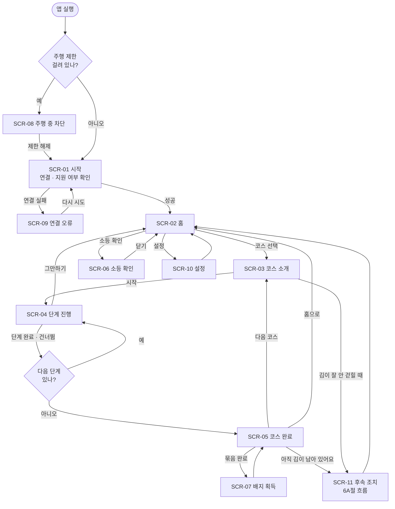
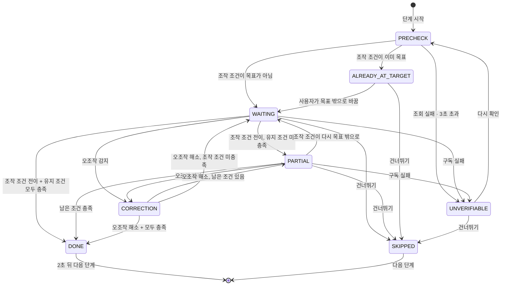
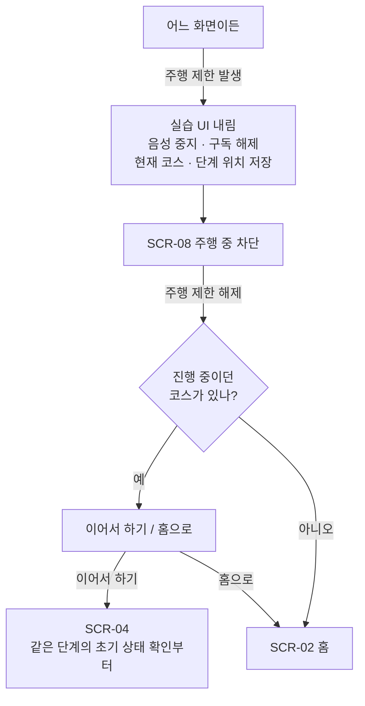
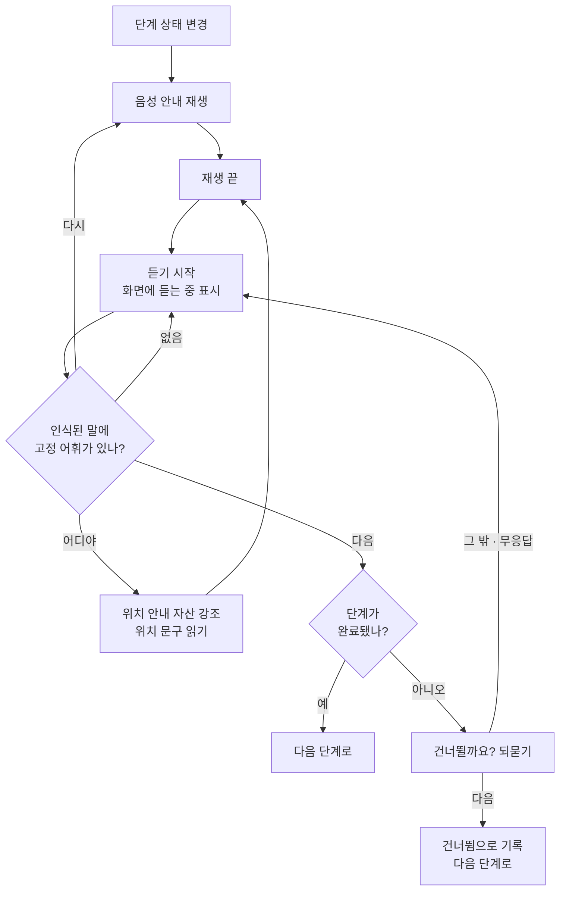
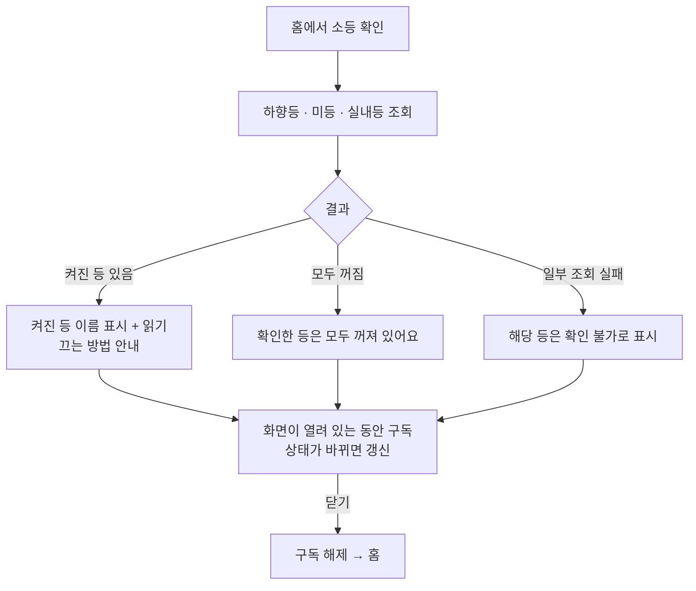
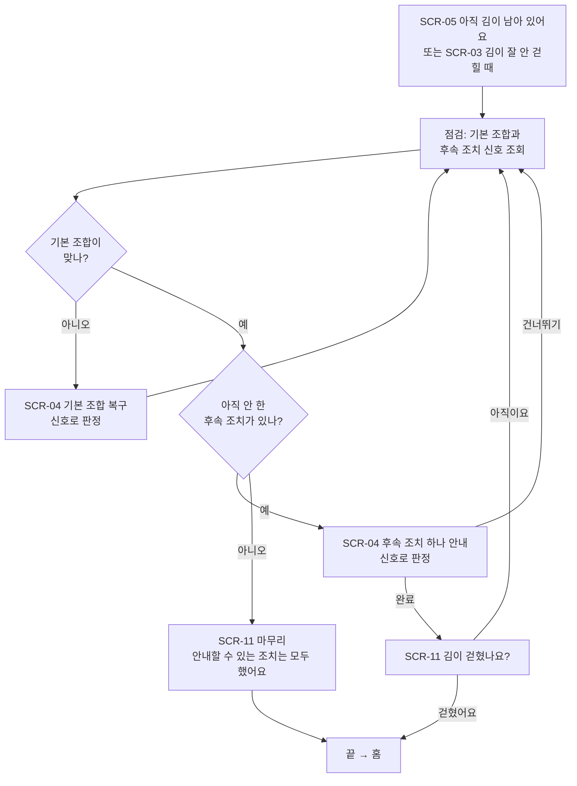

# 사용자 플로우 — 첫 탑승 조작 실습 (가칭)

- 문서 상태: 초안 v0.1 (2026-11-13)
- 관련 문서: [PRD](01-prd.md) · [용어집](02-glossary.md) · [기능 명세서](03-feature-spec.md) · [정책서](05-policy.md)
- **와이어프레임은 Figma에 있다**: [와이어프레임 v0.1](https://www.figma.com/design/7nCbKAdriwwQWVaXXhEIyV/?node-id=0-1) (2026-11-13 작성). 보드 구성: 00 안내 / 01 컴포넌트 / 02 세로형 11종(SCR-11은 2개 상태) / 03 SCR-04 상태 8종과 후속 조치 단계 / 04 가로형 11종(SCR-04는 2개 상태). 프레임 크기는 실측값(세로형 841×1210, 가로형 1682×1210 dp)으로 바꿨다(2026-11-14). 디자인 값은 [디자인 값](08-design-tokens.md).
- 아래 본문의 "보류" 표현은 와이어프레임 작성 전 기준이다.
- SCR-11(후속 조치 확인)과 SCR-03·SCR-05의 후속 조치 진입 버튼은 2026-11-14에 추가했고 Figma 와이어프레임에도 반영했다. 이 문서는 화면이 *어떤 순서로 이어지고 각 화면에 무엇이 있어야 하는지*까지만 정한다. 배치·크기·시각 디자인은 정하지 않는다.
- 다이어그램은 Mermaid 문법이다.

## 1. 화면 목록

| ID | 화면 | 목적 | 관련 기능 |
|---|---|---|---|
| SCR-01 | 시작 | 차량 연결, 지원 여부 확인 | FR-01 |
| SCR-02 | 홈 (코스 목록) | 코스 고르기, 소등 확인 진입 | FR-03, FR-09 |
| SCR-03 | 코스 소개 | 무엇을 익히는지, 몇 단계인지 알리고 시작 | FR-04 |
| SCR-04 | 단계 진행 | 안내 → 조작 → 판정. 제품의 중심 화면 | FR-02, FR-04, FR-05, FR-06 |
| SCR-05 | 코스 완료 | 완료 확인, 켜 둔 것 안내, 다음 코스 | FR-04, FR-14 |
| SCR-06 | 소등 확인 | 켜져 있는 등 알림 | FR-10 |
| SCR-07 | 배지 획득 | 묶음 완료 알림 (SCR-05 위에 겹쳐 표시) | FR-09 |
| SCR-08 | 주행 중 차단 | 실습 UI를 내린 상태 | FR-07 |
| SCR-09 | 연결 오류 | 차량 연결 실패 안내, 다시 시도 | FR-12 |
| SCR-10 | 설정 | 음성 켜기/끄기, 기록 지우기, 숨겨진 코스와 이유 | FR-11, FR-12 |
| SCR-11 | 후속 조치 확인 | 조치 하나가 끝난 뒤 김이 걷혔는지 묻고, 조치가 더 없으면 마무리 안내 | FR-16 |

## 2. 전체 흐름

어느 화면에서든 주행 제한이 걸리면 SCR-08로 간다(4절).

## 3. 단계 진행 화면(SCR-04)의 상태 흐름

SCR-04는 화면 하나지만 판정 상태에 따라 내용이 바뀐다. 상태 이름은 용어집 2절과 같다.

상태별로 화면과 음성이 내는 것:

| 상태 | 화면 | 음성 | 사용자가 할 수 있는 것 |
|---|---|---|---|
| `PRECHECK` | 짧은 진행 표시 | 없음 | 그만하기 |
| `WAITING` | 안내 문구, 위치 안내 자산, 조건 표시 | 안내 문구. 15초 동안 전이가 없으면 위치 문구를 한 번 더 | 순정 버튼 조작 / 다시 듣기 / 어디 있어요 / 건너뛰기 / 그만하기 |
| `ALREADY_AT_TARGET` | "이미 켜져 있어요" + 껐다 켜기 안내 | 같은 내용 | 위와 같음 |
| `PARTIAL` | 충족된 조건과 남은 조건을 따로 표시 | "○○ 확인. △△가 남았어요" | 위와 같음 |
| `CORRECTION` | 교정 안내 + 오조작 대상의 위치 안내 자산 | 교정 안내 문구 | 위와 같음 |
| `DONE` | 조작 완료 표시 | 완료 확인 | (2초 뒤 자동 진행) |
| `UNVERIFIABLE` | "확인 불가" + 다시 확인 버튼 | "지금은 차량 상태를 확인할 수 없어요" | 다시 확인 / 건너뛰기 / 그만하기 |

SCR-04에 **없는 것**: 사용자가 누르는 "완료" 또는 "했어요" 버튼.

## 4. 주행 전환 흐름

SCR-08에 있어야 하는 것: "주행 중에는 사용할 수 없습니다. 정차하면 이어서 할 수 있어요"라는 문구 하나. 버튼, 목록, 움직이는 요소는 없다.

## 5. 음성 진행 흐름 (SCR-04 안에서)

- 듣기 시작 방식(자동 / 마이크 버튼)은 미정이다(PRD D5). 위 그림은 자동 방식 기준이다. 마이크 버튼 방식이면 C → D 사이에 "마이크 버튼 누름"이 들어간다.
- 음성 안내가 재생되는 동안에는 듣지 않는다.
- 신호 전이로 상태가 바뀌면 듣기를 멈추고 A부터 다시 시작한다.

## 6. 소등 확인 흐름 (SCR-06)

화면에 항상 있어야 하는 문구: "주간주행등 등 이 앱이 읽을 수 없는 등이 있습니다."

## 6A. 후속 조치 흐름 (SCR-11)

김서림 제거를 했는데도 김이 남아 있을 때의 안내다(기능 명세서 FR-16). 절 번호가 6A인 것은 뒤 절의 번호를 바꾸지 않기 위해서다.

- 점검(B)은 조치를 고를 때마다 다시 한다. 앞 조치 때문에 차가 함께 바꾼 값이 있으면 그 조치는 제안하지 않는다.
- 조치의 완료는 SCR-04에서 신호로 판정한다. SCR-11의 답은 갈 길만 고른다.
- 주행 제한이나 백그라운드 전환으로 끊기면 이어서 하지 않는다.

## 7. 화면별 필수 요소

와이어프레임을 그릴 때 빠지면 안 되는 것만 적는다. 배치는 정하지 않는다.

### SCR-01 시작
- 앱 이름, 진행 표시(2초를 넘길 때)
- 지원되는 코스가 없을 때의 안내 문구

### SCR-02 홈
- 코스 카드: 이름, 예상 소요 시간, 상태(시작 전 / 완료 / 건너뜀 있음)
- 묶음 구분과 배지 표시 (FR-09 포함 시)
- 첫 실행일 때 대표 코스 강조("여기서 시작")
- 소등 확인 진입 버튼
- 설정 진입
- 없어야 하는 것: 점수, 등급, 순위, 진행률 백분율을 경쟁처럼 보이게 하는 표현

### SCR-03 코스 소개
- 코스 이름, 한 줄 설명(왜 알아야 하는지), 단계 수, 예상 소요 시간
- "정차 상태에서 진행하세요" 안내
- 시작 버튼
- 후속 조치가 정의된 코스에서만: "김이 잘 안 걷힐 때" 진입(FR-16 포함 시). 정차 상태에서 쓰는 기능임을 함께 적는다

### SCR-04 단계 진행
- 안내 문구(한 문장)
- 위치 안내 자산(대상 버튼 강조)
- 조건별 충족 표시(조합 판정 단계)
- 코스 내 진행 위치(예: 2/3)
- 버튼: 다시 듣기 / 어디 있어요 / 건너뛰기 / 그만하기
- 듣는 중 표시, 음성 꺼짐 표시
- 폴링 중인 조건의 "확인 중" 표시
- 상태별 내용은 3절 표

### SCR-05 코스 완료
- 완료 표시(건너뛴 단계가 있으면 "건너뛴 단계가 있어요"와 다시 하기)
- 아직 켜져 있는 것 목록(FR-14 포함 시)
- 후속 조치가 정의된 코스(김서림 제거)에서만: "아직 김이 남아 있어요" 버튼(FR-16 포함 시)
- 버튼: 다음 코스 / 홈으로

### SCR-06 소등 확인
- 등별 상태(켜짐 / 꺼짐 / 확인 불가)
- 읽을 수 없는 등이 있다는 안내 문구
- 닫기

### SCR-07 배지 획득
- 묶음 이름, 배지, 닫기

### SCR-08 주행 중 차단
- 문구 하나. 조작 요소 없음

### SCR-09 연결 오류
- 무슨 일이 있었는지와 할 수 있는 행동, 다시 시도 버튼

### SCR-11 후속 조치 확인
- 지금까지 한 조치 목록(신호로 완료된 것은 ✓, 처음부터 되어 있던 것은 "이미 되어 있어요", 건너뛴 것은 "건너뜀")
- 질문 "김이 걷혔나요?"와 버튼 두 개: 걷혔어요 / 아직이요
- 그만하기
- 마무리 상태일 때: 질문과 버튼 대신 "앱이 안내할 수 있는 조치는 모두 했어요"와 취급설명서·정비소 안내, 홈으로 버튼
- 없어야 하는 것: "했어요" 버튼, 고장을 단정하는 문구, "대신 켜 드릴까요"

### SCR-10 설정
- 음성 안내 켜기/끄기, 음성 진행 켜기/끄기
- 기록 지우기(확인 절차 포함)
- 숨겨진 코스와 숨긴 이유(미지원 / 퍼미션)
- 앱 정보(버전, 기준 차종)

## 8. 2차 PT 시연 흐름과 화면 대응

시연 화면은 "차(VC) │ 앱" 2분할로 고정한다.

| # | 시연 장면 | VC에서 하는 것 | 앱 화면 · 상태 | 보여 주려는 것 |
|---|---|---|---|---|
| 1 | 앱 시작 | — | SCR-01 → SCR-02 | 지원되는 코스만 보인다 |
| 2 | 김서림 제거 시작 | — | SCR-03 → SCR-04 `WAITING` | 음성 안내, 위치 안내 |
| 3 | 제상만 켬 | 앞유리 제상 On | `PARTIAL` "에어컨이 남았어요" | 조합 판정 |
| 3-1 | 일부러 틀리게 조작 | 순환을 내기로 | `CORRECTION` | 오조작 교정 |
| 4 | 조합을 맞춤 | 외기, 에어컨 On | `DONE` → SCR-05 | 신호로 완료 판정 |
| 5 | 전조등 코스 (하향등이 켜진 채 시작) | 미리 Low beam | SCR-04 `ALREADY_AT_TARGET` | 이미 목표면 완료로 치지 않는다 |
| 6 | 껐다 켜기 | Off → Low beam | `DONE` | 전이로 판정한다 |
| 7 | 음성으로 다음 코스 | — ("다음") | SCR-05 → SCR-03 → SCR-04 (와이퍼) | 음성 진행 |
| 8 | "어디야" | — | 위치 안내 자산 강조 | 음성 진행 |
| 9 | 와이퍼 켬 | 와이퍼 Low | `DONE` | |
| 10 | 풍향 단계 | 풍향 Defrost | "확인 중" → `DONE` | 구독이 없는 신호의 처리 |
| 11 | 소등 확인 | 실내등 On | SCR-06 "실내등이 켜져 있어요" | 하차 전 확인 |
| 12 | 주행 전환 | 기어 D | SCR-08 | 정차 전용 (**실측 T10 통과 시에만**) |
| 13 | 확인 불가 | (재현 방법 **실측 T11**) | SCR-04 `UNVERIFIABLE` | 모르면 모른다고 한다. 재현이 안 되면 테스트 실행 화면으로 대신하고 그 사실을 밝힌다 |

## 9. 와이어프레임 작업 때 정할 것 (보류 항목)

적용 시스템(Pleos Connect 앱 창), 세로형·가로형 화면 모델, 수치 규칙, 참고 문서는 [디자인 값](08-design-tokens.md)에 정리했다. 세로형과 가로형을 둘 다 그려야 한다.

- 화면 규격: 에뮬레이터의 화면 규격을 확인한 뒤 정한다(README에 기재해야 함)
- SCR-04의 배치: 위치 안내 자산과 조건 표시의 비중
- 위치 안내 자산의 형식: 대시보드 전체 그림 + 강조 / 조작부 확대 그림
- 상태별 색·아이콘 (확인 불가와 미충족이 구분돼 보여야 한다)
- 듣는 중 표시의 형태
- 배지 디자인과 묶음 이름
- 주행 중 주의 분산 가이드(터치 최소화, 큰 터치 영역) 반영
