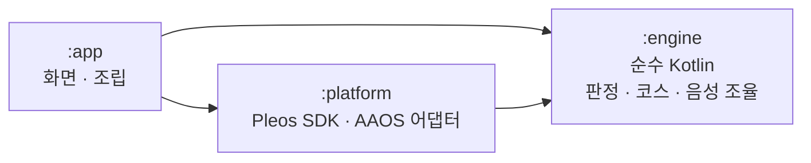
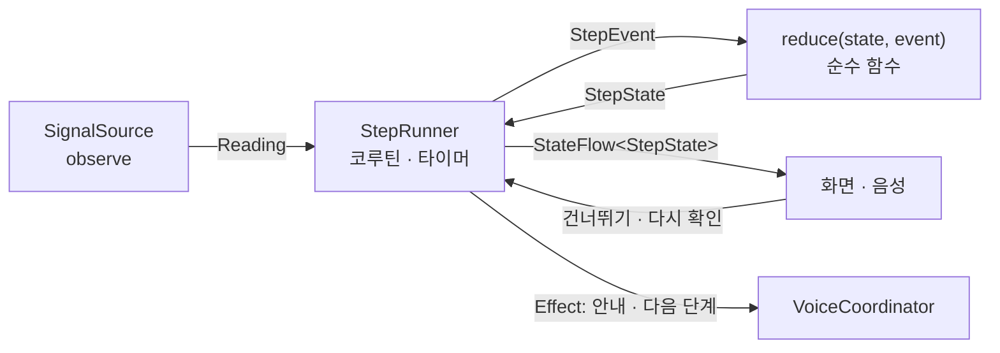
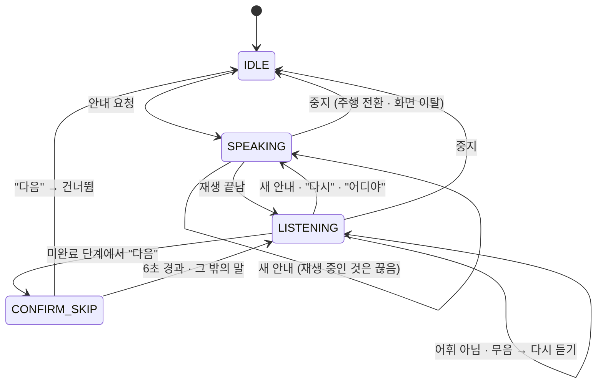
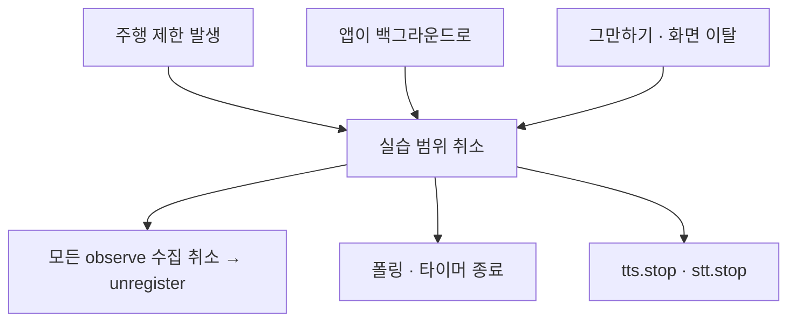

# 기술 설계 문서 — 첫 탑승 조작 실습 (가칭)

- 문서 상태: 초안 v0.1 (2026-11-13)
- 관련 문서: [PRD](01-prd.md) · [용어집](02-glossary.md) · [기능 명세서](03-feature-spec.md) · [사용자 플로우](04-user-flow.md) · [정책서](05-policy.md)
- 표기: **[실측]** 은 에뮬레이터에서 확인한 뒤 확정하는 항목, **[가정]** 은 근거 없이 정한 값, **[미정]** 은 팀 결정이 필요한 항목이다.
- API 형태는 2026-11-13에 Pleos 공식 문서(`document.pleos.ai`)를 직접 열어 확인했다. API Reference 개별 페이지는 열람하지 못해, 가이드 본문에 없는 메서드 이름은 "문서 확인"으로 표시했다.

**1부(1~9절)** 는 에뮬레이터 실측과 무관하게 정한 설계다. **2부(10~13절)** 는 실측 결과에 따라 확정되는 부분이며, 문서 근거로 쓸 수 있는 데까지 쓰고 결과별 분기를 적었다.

---

# 1부. 실측과 무관한 설계

## 1. 설계 목표

| # | 목표 | 근거 |
|---|---|---|
| G1 | **판정 로직을 에뮬레이터 없이 테스트할 수 있다** | 허위 완료 0건(PRD M1). 에뮬레이터는 전용 GPU가 필요해 팀원 모두가 돌릴 수 없을 수 있다 |
| G2 | **코스를 추가할 때 판정 코드를 고치지 않는다** | 기능 명세서 FR-13 |
| G3 | **세 명이 서로를 기다리지 않고 개발한다** | 인터페이스를 먼저 고정한다 |
| G4 | **정책서의 규칙이 코드의 한 곳에 대응한다** | 정책 ID로 코드와 테스트를 찾을 수 있다 |
| G5 | **멈춰야 할 때 확실히 멈춘다** | 주행 전환·백그라운드에서 구독·음성이 남지 않는다(POL-P-1, POL-E-6) |

## 2. 기술 선택

| 항목 | 선택 | 이유 | 대안 |
|---|---|---|---|
| 언어 | Kotlin 2.0.0 | SDK 예제가 Kotlin 우선, 코루틴으로 비동기 콜백을 감싼다. `:engine`은 `kotlin("jvm")`과 `jvmToolchain(17)` | Java |
| 최소 버전 | API 28 (공모전 조건), 대상은 에뮬레이터 이미지(API 34) | | |
| 빌드 | Gradle 8.10.2, AGP 8.8.2, JDK 17, Kotlin DSL | B의 장비에서 release APK 생성까지 확인한 조합(개발 계획 1절). Gradle wrapper는 W-02에서 넣는다 | |
| 화면 | Jetpack Compose, 단일 Activity | 세로형·가로형을 한 코드로 대응하기 쉽다. 상태 → 화면 구조가 판정 상태와 잘 맞는다 **[실측 T13]** | XML View |
| 비동기 | 코루틴 + Flow (kotlinx-coroutines 1.8.1) | SDK의 `onComplete/onFailed`, `registerXxx` 콜백을 `suspend`와 `Flow`로 감싼다 | |
| 의존성 주입 | 직접 조립(앱 시작 시 한 곳에서 생성) | 객체 수가 적다. 라이브러리를 늘리지 않는다 | Hilt |
| 저장 | DataStore (Preferences) | 저장 항목이 10개 안팎(POL-S-1). 데이터베이스가 필요 없다 | Room |
| 코스 정의 | `assets/`의 JSON + kotlinx-serialization-json 1.6.3 (`plugin.serialization`) | 코드와 분리(FR-13) | |
| 테스트 | `kotlin("test")`(JUnit Platform), kotlinx-coroutines-test 1.8.1 (가상 시간) | 타이머(3초, 15초, 2초)를 실제로 기다리지 않고 테스트한다 | |
| 가짜 구현의 위치 | `java-test-fixtures` 플러그인, `engine/src/testFixtures/` | `:engine`의 테스트와 `:app`의 debug 빌드가 같은 가짜 신호원을 쓴다. 본 소스가 아니라서 release APK에 들어가지 않는다(4-2절) | `:app`의 `src/debug/`에 복사 |
| 패키지 | `com.firstride.*` (`:engine`은 `com.firstride.engine`) | **임시값.** 앱 이름(PRD D1)이 정해지면 바꾼다 | |
| 네트워크 | **없음.** 인터넷 퍼미션을 선언하지 않는다 | POL-P-5 | |

화면 기술(Compose)은 **[가정: 팀 숙련도]** 다. View로 바꿔도 3절의 `engine`, `platform` 모듈은 영향을 받지 않는다.

`:engine`의 구성(Kotlin 2.0.0, 라이브러리 버전, 테스트 도구, test fixtures, 패키지)은 A가 2026-11-14에 정해 전달한 것이다. `main`에는 W-03(고정 인터페이스)까지 들어 있다.

**JDK 배포판 주의.** A의 장비(Windows)에서 Eclipse Adoptium JDK 17.0.5로는 Gradle 데몬이 `Bad address: listen` 오류로 죽었고, Amazon Corretto 17.0.12로 바꿔 해결했다. 같은 오류가 나면 JDK 배포판부터 바꿔 본다. wrapper가 들어가기 전까지 A는 `gradle :engine:test --no-daemon`으로 테스트를 돌린다.

## 3. 모듈 구조

Gradle 모듈 세 개로 나눈다. 의존 방향은 한쪽으로만 흐른다.



| 모듈 | 종류 | 들어가는 것 | 의존 |
|---|---|---|---|
| `:engine` | **순수 Kotlin/JVM** (Android 의존 없음) | 신호 인터페이스, 판정 엔진, 코스 모델·검증, 음성 조율 로직, 진행 기록 규칙. 가짜 구현(테스트·개발용)은 `src/testFixtures/`에 따로 둔다 | 없음 |
| `:platform` | Android 라이브러리 | Vehicle SDK 어댑터, TTS·STT 어댑터, 주행 제한 감지, DataStore 저장소 | `:engine`, Pleos SDK |
| `:app` | Android 앱 | Compose 화면, ViewModel, 조립, 매니페스트, `assets/`(코스 정의, 위치 안내 자산) | `:engine`, `:platform` |

- `:engine`이 순수 Kotlin이라 `./gradlew :engine:test`가 에뮬레이터 없이, 어느 PC에서든 몇 초 안에 돈다(G1).
- `:engine`은 Pleos SDK 타입을 모른다. SDK 버전이 바뀌거나 메서드 이름이 예상과 달라도 `:platform`만 고친다.

**패키지** (`:engine`)

```
signal/     SignalId, SignalValue, Reading, SignalSource, Signals(신호 ID와 값 목록)
course/     CourseDefinition, StepDefinition, Condition, Target, CourseValidator
judge/      StepState, Phase, StepEvent, reduce(), StepRunner, CourseRunner
voice/      VoicePort(Tts, Stt), VoiceCoordinator, VocabularyMatcher
progress/   CourseResult, ProgressStore(인터페이스), BadgeRule
drive/      DriveState, DrivingGate(인터페이스)
```

패키지의 뿌리는 `com.firstride.engine`이다(임시값). `FakeSignalSource`와 가짜 음성 포트는 `engine/src/testFixtures/kotlin/` 아래 같은 패키지에 둔다.

**담당 나누기 (제안)** **[미정]**

| 담당 | 범위 | 먼저 필요한 것 |
|---|---|---|
| A | `:engine` — 판정 엔진, 코스 검증, 테스트 | 4절·5절 인터페이스 |
| B | `:platform` — SDK 어댑터, 에뮬레이터 실측(10절·13절) | 4절 인터페이스, 에뮬레이터 장비 |
| C | `:app` — 화면, 위치 안내 자산, 코스 정의 작성 | `FakeSignalSource`, 와이어프레임 |

4절의 `SignalSource`와 6절의 코스 정의 형식을 첫날 고정하면 A·B·C가 각자 진행할 수 있다. C는 가짜 신호원으로 에뮬레이터 없이 화면을 만든다.

## 4. 신호 계층

판정 엔진이 차량 신호를 읽는 유일한 통로다. Vehicle SDK의 세 가지 호출(지원 여부, 조회, 구독)을 하나의 형태로 감싼다.

### 4-1. 인터페이스

```kotlin
// :engine  signal/
@JvmInline value class SignalId(val key: String)          // 예: "hvac.frontDefroster"

sealed interface SignalValue {
    data class Token(val name: String) : SignalValue      // "ON", "OFF", "FRESH", "LOW" …
    data class Number(val value: Int) : SignalValue       // 풍량 단수, 창문 위치
}

sealed interface Reading {
    data class Value(val value: SignalValue) : Reading
    data class Failed(val reason: FailReason) : Reading   // PERMISSION, UNSUPPORTED, CONNECTION, EMPTY, TIMEOUT, UNKNOWN
}

enum class Support { SUPPORTED, UNSUPPORTED, DENIED, UNKNOWN }

interface SignalSource {
    /** 지원 여부. checkXxxCapabilities의 AccessType이 READ 또는 READ_WRITE면 SUPPORTED. */
    suspend fun support(id: SignalId): Support

    /** 현재 값을 한 번 읽는다. 시간 제한은 호출하는 쪽이 건다. */
    suspend fun read(id: SignalId): Reading

    /**
     * 값의 변화를 흘려보낸다. 계약:
     *  1. 수집을 시작하면 현재 값을 먼저 한 번 내보낸다.
     *  2. 같은 값은 연달아 내보내지 않는다.
     *  3. 수집을 취소하면 구독을 해제한다(unregister). 남는 리스너가 없다.
     *  4. 구독이 없는 신호는 내부에서 폴링한다. 호출하는 쪽은 차이를 모른다.
     *  5. 실패는 예외가 아니라 Reading.Failed로 내보낸다.
     */
    fun observe(id: SignalId): Flow<Reading>

    /** 폴링으로 읽는 신호인지. 화면의 "확인 중" 표시에만 쓴다. */
    fun isPolled(id: SignalId): Boolean

    /** 숫자 신호의 지원 범위(checkXxxCapabilities의 AreaBounds). 범위를 모르면 null. */
    suspend fun range(id: SignalId): IntRange?
}
```

설계 결정:

| 결정 | 이유 |
|---|---|
| 값은 SDK의 enum이 아니라 **토큰 문자열과 숫자**로 정규화한다 | 코스 정의(JSON)가 SDK 타입을 몰라도 된다. 차종마다 값 이름이 달라도 어댑터가 흡수한다 |
| `observe`가 **현재 값을 먼저** 내보낸다 | SDK가 등록 직후 현재 값을 주는지는 문서에 없다(실측 T4). 어댑터가 조회 후 등록하는 것으로 계약을 고정하면 엔진은 결과와 무관하다 |
| 수집 취소 = 구독 해제 | 구독 정리를 코루틴의 구조화된 취소에 맡긴다. 해제를 잊을 수 없다(G5, 기능 명세서 AC-02-10) |
| 실패를 값으로 다룬다 | "확인 불가"는 정상 흐름의 한 상태다(POL-J-19). 예외로 흘리면 처리가 빠지기 쉽다 |
| SDK가 `null`을 주면 `Failed(EMPTY)` | SDK의 값 타입이 `Int?`처럼 nullable이다. 값이 없는 것을 "꺼짐"으로 읽지 않는다(POL-P-4) |

### 4-2. 가짜 신호원

```kotlin
class FakeSignalSource : SignalSource {
    fun set(id: SignalId, value: SignalValue)     // 값을 바꾼다 → observe로 흘러간다
    fun fail(id: SignalId, reason: FailReason)    // 실패를 주입한다
    fun setSupport(id: SignalId, support: Support)
    val activeSubscriptions: Int                  // 테스트에서 누수 확인
}
```

쓰임새는 두 가지다.
1. **단위 테스트.** 판정 엔진의 모든 테스트가 이것으로 돈다.
2. **화면 개발.** debug 빌드에서만 가짜 신호원과 값을 바꾸는 개발자 패널을 켠다. 에뮬레이터가 없는 PC에서도 화면을 만들 수 있다.

**release 빌드에 들어가지 않게 하는 방법.** 가짜 신호원은 `:engine`의 본 소스가 아니라 test fixtures(`engine/src/testFixtures/`)에 둔다. `:engine`의 테스트는 이것을 자동으로 쓰고, `:app`은 debug 빌드에서만 가져온다.

```kotlin
// app/build.gradle.kts
dependencies {
    implementation(project(":engine"))
    debugImplementation(testFixtures(project(":engine")))   // release에는 없다
}
```

가짜 신호원을 고르는 조립 코드와 개발자 패널은 `:app`의 `src/debug/`에 둔다. `src/main/`과 `src/release/`는 가짜 구현의 클래스를 참조하지 않는다. 테스트용 더미 데이터를 금지하는 Pleos 심사 기준과 부딪치지 않게 하기 위해서다.

Android 모듈의 `debugImplementation`에서 JVM 모듈의 test fixtures를 가져오는 구성이 AGP 8.8.2에서 실제로 되는지는 B가 W-02에서 확인한다 **[실측 T17]**. 안 되면 가짜 구현을 별도 모듈(`:engine-fakes`)로 떼어 `debugImplementation`으로 가져온다.

### 4-3. 신호 목록

엔진과 코스 정의가 쓰는 신호 이름이다. SDK 메서드 대응은 10절에 있다.

| 신호 ID | 값 | 쓰는 코스 |
|---|---|---|
| `hvac.frontDefroster` | `ON` / `OFF` | CRS-01 |
| `hvac.rearDefroster` | `ON` / `OFF` | CRS-02 |
| `hvac.ac` | `ON` / `OFF` | CRS-01 |
| `hvac.recirculation` | `FRESH` / `RECIRCULATE` | CRS-01 |
| `hvac.fanSpeed` | 숫자 (VC 기준 0~8) | CRS-02 |
| `hvac.fanDirection` | `FACE` / `FLOOR` / `DEFROST` … | CRS-02 (폴링) |
| `light.lowBeam` | `ON` / `OFF` | CRS-03, CHK-01 |
| `light.tailLamp` | `ON` / `OFF` | CRS-03, CHK-01 |
| `light.cabin` | `ON` / `OFF` | CHK-01 |
| `wiper.state` | `OFF` / `AUTO` / `LOW` / `HIGH` | CRS-04 |
| `turnSignal.state` | `OFF` / `LEFT` / `RIGHT` | CRS-05 |
| `window.driverPosition` | 숫자 | CRS-06 |
| `window.lock` | `ON` / `OFF` | CRS-06 |
| `door.lock` | `LOCKED` / `UNLOCKED` | CRS-06 |
| `hvac.maxDefrost` | `ON` / `OFF` | CRS-01 후속 조치 |
| `hvac.temperature` | 숫자 (0.1℃ 단위의 정수. 22.5℃ → 225) | CRS-01 후속 조치 |

값 이름은 설계상의 이름이다. SDK가 실제로 주는 값과의 대응은 어댑터가 맡고, 실측 T6으로 확정한다. 어댑터는 표의 값으로 바꿀 수 없는 SDK 값(예: 와이퍼의 간헐 단, 등화의 `DAYTIME_RUNNING`)을 SDK 이름 그대로 토큰으로 낸다. 이런 값은 어떤 목표와도 맞지 않아 완료로도 꺼짐으로도 읽히지 않는다.

## 5. 판정 엔진

정책서 2절(POL-J-1~25)을 코드로 옮긴 부분이다. **순수 함수 하나와 그것을 돌리는 실행기**로 나눈다.

### 5-1. 구조



| 구성 | 하는 일 | 테스트 방법 |
|---|---|---|
| `reduce(state, event): StepState` | 판정 규칙 전부. 입력이 같으면 출력이 같다. 시간, 코루틴, I/O가 없다 | 표 기반 단위 테스트. 정책 하나에 테스트 하나 이상 |
| `StepRunner` | 신호 구독을 이벤트로 바꾼다. 시간 제한(3초), 힌트(15초), 자동 진행(2초)을 건다 | 가짜 신호원 + 가상 시간 |
| `CourseRunner` | 단계를 순서대로 돌리고 코스 결과를 낸다 | 가짜 신호원 |

규칙을 순수 함수에 모으는 이유: 허위 완료가 생길 수 있는 곳을 한 파일로 좁힌다. 리뷰와 테스트를 그 파일에 집중한다(G4).

### 5-2. 상태

```kotlin
enum class Phase { PRECHECK, WAITING, ALREADY_AT_TARGET, PARTIAL, CORRECTION, DONE, UNVERIFIABLE, SKIPPED }

data class StepState(
    val phase: Phase,
    val conditions: List<ConditionState>,
    val correction: MisoperationDef? = null,   // phase == CORRECTION일 때
)

data class ConditionState(
    val def: ConditionDef,                     // 조작 조건 또는 유지 조건
    val initial: SignalValue? = null,          // 단계 시작 시 읽은 값
    val current: SignalValue? = null,
    val failed: Boolean = false,
    val seenOffTarget: Boolean = false,        // 이번 단계에서 목표가 아닌 값이었던 적이 있는가
    val polled: Boolean = false,
) {
    val atTarget: Boolean get() = current != null && def.target.matches(current, initial)
    val satisfied: Boolean get() = when (def.kind) {
        Kind.ACTION -> seenOffTarget && atTarget     // POL-J-3, POL-J-4
        Kind.HOLD   -> atTarget                      // POL-J-5
    }
}
```

`seenOffTarget` 하나로 세 가지 정책이 풀린다.

| 상황 | `seenOffTarget` | `atTarget` | 충족 | 정책 |
|---|---|---|---|---|
| 시작할 때 이미 켜져 있음 | false | true | ✕ | POL-J-11 |
| 껐다가 | true | false | ✕ | |
| 다시 켬 | true | true | ○ | POL-J-3 |
| 켠 뒤 다시 끔 | true | false | ✕ | POL-J-4 (고정되지 않음) |

### 5-3. 이벤트

```kotlin
sealed interface StepEvent {
    data class Prechecked(val readings: Map<SignalId, Reading>) : StepEvent
    data class Changed(val id: SignalId, val reading: Reading) : StepEvent
    data object PrecheckTimedOut : StepEvent
    data object Skip : StepEvent
    data object Retry : StepEvent        // "다시 확인" → PRECHECK로
}
```

### 5-4. 단계 상태를 정하는 규칙

`reduce`는 조건 상태를 갱신한 뒤 아래 순서로 단계 상태를 정한다. 위에서부터 처음 맞는 것이 답이다.

| 순서 | 조건 | 결과 | 정책 |
|---|---|---|---|
| 1 | 이미 `DONE` 또는 `SKIPPED` | 그대로 | POL-J-8 |
| 2 | 조건 중 하나라도 실패 | `UNVERIFIABLE` | POL-J-21, J-22 |
| 3 | 모든 조작 조건 충족 + 모든 유지 조건 충족 | `DONE` | POL-J-6 |
| 4 | 오조작 규칙에 해당하고 교정을 낼 자격이 있음 | `CORRECTION` | POL-J-15, J-16 |
| 5 | 조작 조건 중 `seenOffTarget == false`이고 `atTarget`인 것이 있음 | `ALREADY_AT_TARGET` | POL-J-11 |
| 6 | 모든 조작 조건 충족 (유지 조건이 남음) | `PARTIAL` | |
| 7 | 그 밖 | `WAITING` | |

4번의 "교정을 낼 자격": (a) 조작 조건이 하나라도 충족됐거나 (b) 오조작 신호의 현재 값이 단계 시작 시 값과 다르다. 시작할 때부터 오조작 상태였고 아직 아무 조작도 없으면 자격이 없다.

### 5-5. 목표의 종류

```kotlin
sealed interface Target {
    data class Equals(val value: SignalValue) : Target                   // 값이 같음
    data class Relative(val direction: Direction) : Target               // 시작 값보다 커짐/작아짐 (POL-J-10)
    data object AtMax : Target                                           // 지원 범위의 최댓값 (후속 조치용, 범위는 SignalSource.range)
    fun matches(current: SignalValue, initial: SignalValue?): Boolean
}
```

- `Relative`는 풍량 한 단 올리기, 창문 내리기에 쓴다. 기준은 단계 시작 시 값이다. 시작 값이 끝값이면 `StepRunner`가 방향을 뒤집고 코스 정의의 대체 안내 문구(`instructionAtLimit`)를 쓴다.
- `Relative` 조건은 시작할 때 항상 미충족이므로 `seenOffTarget`을 처음부터 true로 둔다.

### 5-6. StepRunner의 시간 처리

| 시간 | 처리 | 정책 |
|---|---|---|
| 초기 상태 확인 3초 | 모든 조건을 동시에 `read`. 3초 안에 다 오지 않으면 `PrecheckTimedOut` → `UNVERIFIABLE` | POL-J-19 |
| 힌트 15초 | `WAITING`에 들어온 뒤 15초 동안 상태 변화가 없으면 위치 안내를 한 번 내보낸다. 단계당 한 번 | POL-V-5 |
| 자동 진행 2초 | `DONE` 뒤 2초를 기다려 다음 단계로. 이 사이의 신호 변화는 무시된다(규칙 1번) | POL-J-8 |

시간 값은 `JudgeConfig` 한 곳에 둔다(정책서 12절과 같은 표). 시계와 디스패처를 주입받아 테스트에서 가상 시간으로 돌린다.

### 5-7. CourseRunner와 진행 기록

```kotlin
enum class CourseResult { NOT_STARTED, HAS_SKIPPED, COMPLETED }   // 순서가 곧 우열

interface ProgressStore {
    suspend fun result(courseId: String): CourseResult
    suspend fun record(courseId: String, attempt: CourseResult)   // max(저장값, attempt)로 저장 (POL-R-7)
    suspend fun badges(): Set<String>
    suspend fun clearAll()                                         // 설정값은 남긴다 (POL-S-5)
}
```

- 시도가 끝까지 가야 `record`를 부른다. "그만하기"는 부르지 않는다(POL-R-6).
- 배지 판정은 `BadgeRule` 순수 함수다. 입력은 묶음의 보이는 코스와 각 코스의 결과다(POL-R-14, R-15).
- 소요 시간, 시도 횟수는 모델에 필드가 없다(POL-R-9). 넣을 수 없게 하는 것이 정책을 지키는 가장 쉬운 방법이다.

### 5-8. 후속 조치 실행기 (FR-16)

판정 엔진을 그대로 쓴다. 새로 필요한 것은 **무엇을 다음 단계로 낼지 고르는 부분**뿐이다.

```kotlin
sealed interface FollowUpNext {
    data class RestoreBase(val step: StepDefinition) : FollowUpNext   // 기본 조합이 어긋남 (POL-F-11)
    data class Offer(val followUp: FollowUpDef) : FollowUpNext        // 아직 안 된 조치
    data object Exhausted : FollowUpNext                              // 남은 조치 없음 (POL-F-7)
}

/** 순수 함수. 방금 읽은 값으로 다음에 할 일을 고른다. */
fun chooseNext(
    course: CourseDefinition,
    readings: Map<SignalId, Reading>,
    ranges: Map<SignalId, IntRange?>,
    support: Map<SignalId, Support>,
    alreadyOffered: Set<String>,          // 이번 안내에서 이미 낸 조치 (완료·건너뜀)
): FollowUpNext
```

| 규칙 | 구현 | 정책 |
|---|---|---|
| 기본 조합 복구가 먼저 | 코스 마지막 단계의 목표 상태가 지금 값과 다르면 `RestoreBase` | POL-F-11 |
| 이미 된 조치는 내지 않는다 | 목표가 지금 값과 맞으면 건너뛴다 | POL-F-4 |
| 미지원 조치는 내지 않는다 | `support`가 `SUPPORTED`가 아니면 건너뛴다 | |
| 고를 때마다 새로 읽는다 | `FollowUpRunner`가 `chooseNext`를 부르기 전에 매번 `read`한다 | POL-F-5 |
| 조치의 완료는 신호로 | 고른 조치를 `StepDefinition`으로 바꿔 `StepRunner`에 넘긴다. `reduce`를 고치지 않는다 | POL-F-2 |
| 답은 갈 길만 고른다 | "아직이요" → 다시 `chooseNext`. "걷혔어요" → 종료. 답을 저장하지 않는다 | POL-F-2, F-8 |

`chooseNext`가 고른 조치는 시작 시점에 미충족임이 보장되므로 `StepRunner`에서 `ALREADY_AT_TARGET`이 나오지 않는다. 읽은 직후 사용자가 값을 바꿔 그 사이에 충족되면 엔진의 기존 규칙대로 `ALREADY_AT_TARGET`이 되고, 건너뛰면 다음 `chooseNext`에서 "이미 되어 있음"으로 빠진다.

`FollowUpRunner`는 진행 기록 저장소를 받지 않는다. 코스 결과와 배지를 바꿀 수단이 없다(POL-F-8).

### 5-9. 원상 복귀 안내 (FR-14)

목록 이름은 `coveredSignals`가 신호별 첫 조건 라벨을 사용한다. 같은 신호를 여러 방향으로 다루는 코스는 라벨을 조작부 이름으로 통일한다(예: "방향지시등"). 왼쪽·오른쪽 목표는 단계 안내와 완료 문구로 구분해, 복귀 목록이 현재 점등 방향을 잘못 단정하지 않게 한다.

`snapshotBefore`는 코스가 다루는 신호를 동시에 조회하고, 각 조회를 `JudgeConfig.precheckTimeout`(기본 3초)으로 제한한다. 미응답·실패 값은 기준에 넣지 않아 다른 신호의 확인을 막거나 복구됐다고 단정하지 않는다.

`CourseRunner.run`이 같은 실습 범위에서 이 조회를 마친 뒤 첫 단계를 시작한다. 앱은 별도의 조회 코루틴을 띄우지 않고 실행기의 `initialValues`를 원상 복귀 기준으로 사용한다. 주행·백그라운드 전환으로 준비를 취소하면 읽기도 함께 취소한다. 준비 완료 전에 취소되면 기준 전체를 미확인으로 두며 재개 시 새 값으로 덮지 않는다. 정상 준비 뒤 재개는 원래 기준을 유지하고, 완료 후 새 시도는 기준도 새로 읽는다. 값은 메모리에만 둔다.

`observeRestore`도 신호마다 첫 응답만 같은 시간으로 제한한다. 기한 안에 값이 없거나 값 없이 끝나면 `unverified`로 표시한다. 관찰은 유지하므로 늦은 실제 값과 사용자의 원상 복귀는 계속 반영하며, 최초 응답 뒤 값이 그대로인 것은 시간 초과가 아니다. 화면 수집 취소 시 채널과 원본 구독도 취소한다. 두 함수의 기존 호출은 기본 설정을 그대로 사용한다. SignalSource 포트·코스 JSON·영속 형식은 바꾸지 않는다.

### 5-10. 소등 확인 관찰 (FR-10)

`supportedLights`는 지원 여부를 동시에 확인하고 기존 등 순서를 유지한다. `observeLights`는 지원되는 등만 관찰하며, 최초 응답이 기본 3초 안에 없으면 해당 등을 `UNKNOWN`으로 낸다. 일부 미응답이 다른 등 표시를 막지 않고, 전부 미응답이면 `NONE_READABLE`이다. 이후 실제 값·변경은 계속 반영한다. 처음부터 정상 응답한 값이 오래 유지되는 것은 실패가 아니다. 지원하는 등이 없으면 구독 없이 빈 결과를 반환한다.

최초 응답 제한은 원상 복귀 안내와 같은 내부 함수 `observeWithInitialTimeout`을 사용한다. SignalSource 인터페이스는 유지하며 화면·실습 수집이 취소되면 원본 관찰과 첫 값 대기도 함께 정리한다.

## 6. 코스 정의

### 6-1. 파일 구조

차종과 무관한 것과 차종에 묶인 것을 나눈다(기능 명세서 AC-13-4).

```
app/src/main/assets/
  courses/                       ← 차종 공통: 신호, 목표, 오조작 규칙, 상태 문구
    CRS-01.json
    …
    bundles.json                 ← 묶음과 순서
  models/<기준차종>/              ← 차종별: 버튼 위치 문구, 위치 안내 자산
    CRS-01.json
    assets/hvac_front_defrost.webp
```

차종을 추가하는 일 = `models/<새 차종>/` 폴더 하나를 더하는 일이다.

### 6-2. 형식

`courses/CRS-01.json` (차종 공통)

```json
{
  "id": "CRS-01",
  "name": "김서림 제거",
  "estimatedSeconds": 60,
  "steps": [
    {
      "id": "CRS-01-S1",
      "action": [ { "signal": "hvac.frontDefroster", "equals": "ON", "label": "앞유리 제상" } ],
      "hold":   [ { "signal": "hvac.ac", "equals": "ON", "label": "에어컨" },
                  { "signal": "hvac.recirculation", "equals": "FRESH", "label": "외기 유입" } ],
      "misoperations": [
        { "id": "recirc", "when": { "signal": "hvac.recirculation", "equals": "RECIRCULATE" },
          "correction": "내기 순환이 켜져 있어요. 외기로 바꿔야 김이 빨리 걷혀요." }
      ],
      "doneText": "좋아요. 김서림 제거가 켜졌어요."
    }
  ]
}
```

`models/<기준차종>/CRS-01.json` (차종별)

```json
{
  "courseId": "CRS-01",
  "steps": {
    "CRS-01-S1": {
      "instruction": "부채꼴 모양의 앞유리 김서림 제거 버튼을 누르세요.",
      "locatorText": "차량의 공조 조작부를 확인해 주세요.",
      "locatorAsset": "assets/hvac_front_defrost.webp",
      "conditionLocators": { "hvac.ac": "assets/hvac_ac.webp" },
      "misoperationLocators": { "recirc": "assets/hvac_recirculation.webp" }
    }
  }
}
```

후속 조치가 있는 코스는 차종 공통 파일에 `followUps`를 순서대로 적는다(기능 명세서 FR-16).

```json
{
  "id": "CRS-01",
  "followUps": [
    { "id": "CRS-01-F1", "condition": { "signal": "hvac.maxDefrost", "equals": "ON",  "label": "최대 제상" } },
    { "id": "CRS-01-F2", "condition": { "signal": "hvac.fanSpeed",   "atMax": true,   "label": "풍량" } },
    { "id": "CRS-01-F3", "condition": { "signal": "hvac.temperature", "atMax": true,  "label": "온도" } }
  ],
  "exhaustedText": "앱이 안내할 수 있는 조치는 모두 했어요. 김이 계속 남으면 취급설명서를 확인하거나 정비소에 문의하세요."
}
```

- 기본 조합은 따로 적지 않는다. 코스 마지막 단계의 조작 조건과 유지 조건을 합친 것이 기본 조합이다.
- 조치의 안내 문구와 위치 안내 자산은 차종별 파일에 단계와 같은 형식으로 적는다.
- 검증에 더하는 것: 후속 조치의 신호가 4-3절에 있다, `atMax`는 숫자 신호에만 쓴다, 차종별 파일에 모든 조치의 문구와 자산이 있다.

### 6-3. 검증

`CourseValidator`가 아래를 검사한다. 하나라도 어긋나면 오류다(POL-E-5).

| 검사 | 예 |
|---|---|
| 신호 ID가 4-3절 목록에 있다 | `hvac.frontDefroster` 오타 |
| 목표 값이 그 신호가 가질 수 있는 값이다 | `hvac.ac`에 `FRESH` |
| 단계마다 조작 조건이 하나 이상 있다 | 유지 조건만 있는 단계 |
| 차종별 파일에 모든 단계의 안내 문구와 위치 안내 자산이 있다 | 자산 누락(POL-C-7) |
| 자산 파일이 실제로 있다 | 경로 오타 |
| 문구가 길이 제한을 넘지 않는다 | 3줄 초과(POL-W-4) |

검증을 도는 때는 두 번이다. (1) **단위 테스트**가 `assets/`의 모든 정의를 읽어 검증한다. 잘못된 정의는 빌드 단계에서 걸린다. (2) 앱 시작 때 한 번 더 한다.

## 7. 음성 조율

음성 안내(TTS)와 음성 진행(STT)이 서로 겹치지 않게 순서를 잡는 부분이다. 정책서 5절(POL-V-1~16)을 옮긴다.

### 7-1. 포트

```kotlin
// :engine  voice/   — SDK를 모르는 인터페이스
interface TtsPort { suspend fun speak(text: String): SpeakResult   /* 끝남 / 끊김 / 오류 */
                    fun stop() }
interface SttPort { suspend fun listenOnce(): ListenResult         /* 최종 텍스트 / 무음 / 오류 */
                    fun stop() }
```

- `speak`는 재생이 끝날 때까지 기다리는 `suspend` 함수다. SDK의 `speak()` 호출 뒤 `EventListener.onDone()`/`onStop()`/`onError()`를 기다려 결과로 돌려준다.
- `listenOnce`는 SDK의 `request()` 호출 뒤 `ResultListener.onUpdated(stt, completed = true)`의 텍스트를 돌려준다. 중간 결과(`completed = false`)는 쓰지 않는다. `onEndedRecognition()`만으로는 완료하지 않는다. 실측 T9에서 종료 뒤 약 3~5ms 후 최종 텍스트가 왔다. 빈 최종 결과 또는 명시적 stop은 무음이며, 최종 결과가 없으면 15초 제한 뒤 오류다.
- STT SDK는 요청 ID를 주지 않으므로 `OneShotStt`가 요청마다 SDK 인스턴스와 결과를 함께 소유한다. 초기화 제한은 5초이며 정상·실패·취소·시간 초과 모두 리스너를 제거하고 stop/release한 후 다음 요청을 시작한다. 이미 닫힌 인식기의 콜백은 다음 요청을 완료할 수 없다. 임의의 유예 시간에 의존하지 않는다.
- STT 어댑터가 없거나 듣기가 비활성이면 `sttAvailable`은 처음부터 false다. 현재 앱의 STT는 실제 발화 검증 전까지 미연결이며, 화면에 음성 진행 꺼짐·터치 진행을 표시한다. TTS 안내는 독립적으로 유지한다(AC-06-6).
- SDK 3.3.1의 [공식 이벤트 설명](https://document.pleos.ai/docs/pleos-only/connect-sdk-pleos/SpeechToText/result-listeners)은 최종 결과를 `completed=true`로 정의하며, 해제 전에 등록한 리스너를 제거하도록 안내한다. 실제 마이크의 세 어휘 정확도와 연속 발화는 T9 검증이 추가로 필요하다.

### 7-2. 흐름



| 규칙 | 구현 | 정책 |
|---|---|---|
| 재생 중에는 듣지 않는다 | `LISTENING`은 `speak`가 끝난 뒤에만 들어간다 | POL-V-11 |
| 새 안내가 오면 끊는다 | `SPEAKING`에서 새 요청 → `tts.stop()` 뒤 새 `speak` | POL-V-2 |
| 같은 문구 3초 안 반복 금지 | 마지막 문구와 시각을 기억해 걸러 낸다 | POL-V-3 |
| 연달아 바뀌면 마지막만 | 안내 요청을 최신 값만 남기는 방식으로 받는다(`conflate`) | POL-V-4 |
| 음성 실패는 진행을 막지 않는다 | 포트의 오류 결과는 `IDLE`로 가고 화면에 "음성 꺼짐"만 표시 | POL-E-4 |
| 음성으로 파괴적 동작 금지 | 조율기가 낼 수 있는 동작은 `Next`, `Repeat`, `Where`, `ConfirmSkip`뿐이다. 그만하기·기록 지우기는 종류 자체가 없다 | POL-V-16 |

### 7-3. 어휘 매칭

```kotlin
enum class Vocab { NEXT, REPEAT, WHERE }
fun matchVocabulary(text: String): Vocab?
```

순수 함수다. 공백과 문장부호를 지우고 "다음", "다시", "어디야"가 들어 있는지 본다. 둘 이상 들어 있으면 `null`이다(POL-V-9). 인식 결과의 변형("어디 야", "어디야?", "다음으로")은 테스트 표로 관리한다.

### 7-4. 모드

TTS와 STT 모두 **`Mode.ON_DEVICE`** 로 쓴다.

| 이유 | 설명 |
|---|---|
| 네트워크를 쓰지 않는다 | `HYBRID`·`SERVER`는 음성을 서버로 보낸다. POL-P-5, POL-S-4와 어긋난다 |
| 앱 등록이 필요 없다 | 서버 모드는 Pleos Playground의 자격 증명 등록이 필요하다 |
| 로케일 | `setLocale(Locale.KOREA)`. 문서상 TTS·STT 모두 `ko-KR` 지원 |

## 8. 주행 전환과 앱 생명주기

### 8-1. 주행 제한 감지

```kotlin
// :engine  drive/
enum class DriveState { PARKED, RESTRICTED }
interface DrivingGate { val state: StateFlow<DriveState> }
```

`:platform`의 구현은 AAOS `CarUxRestrictionsManager`에 리스너를 등록하고 `isRequiresDistractionOptimization()`이 참이면 `RESTRICTED`로 둔다. 초기값은 **`RESTRICTED`** 다. 첫 값을 받기 전이나 등록에 실패하면 제한 상태로 남는다(POL-D-7).

### 8-2. 멈추는 방법

구독, 폴링, 음성, 타이머를 **하나의 코루틴 범위**(실습 범위) 아래에 둔다. 멈춰야 할 때 그 범위 하나를 취소한다.



각 기능이 스스로 "멈춰야 하나"를 판단하지 않는다. 멈춤의 원인이 늘어도 취소하는 곳은 하나다(G5).

| 상황 | 범위 취소 | 기억하는 것 | 돌아왔을 때 | 정책 |
|---|---|---|---|---|
| 주행 제한 | ○ | 코스, 단계 번호, 시각 | 이어서 하기를 묻고, 같은 단계의 초기 확인부터 | POL-D-6, R-10, R-11 |
| 백그라운드 | ○ | 위와 같음 | 같은 단계의 초기 확인부터 | POL-E-6 |
| 창 크기·방향 변경 | ✕ | 전부(메모리에 그대로) | 변화 없음 | POL-E-8 |
| 그만하기 | ○ | 없음 | 홈 | POL-R-6 |
| 앱 종료 후 재실행 | — | 완료 기록과 배지만 | 홈. 이어서 하기를 묻지 않음 | POL-R-13 |

재개할 때는 같은 `CourseRunner`의 단계 위치에서 새 `StepRunner`를 만들어 신호를 다시 조회한다. 단계 안의 값·충족·타이머는 보존하지 않는다. 이전 단계의 건너뜀 여부만 시도 결과 집계로 메모리에 남겨, 재개 뒤 `HAS_SKIPPED`를 `COMPLETED`로 잘못 기록하지 않는다(POL-R-5). 시작 전 원상 복귀 값도 같은 시도의 것을 유지한다. 30분 유효 시간은 앱·정차 복귀와 재개 버튼에서 확인한다.

이전 실습 범위의 자식 음성·구독 정리가 끝난 뒤 다음 실습 범위를 시작한다. 빠른 재개에서도 이전 `stop`이 새 안내를 끊지 않도록 AppViewModel의 실습 시작을 직렬화한다.

소등 확인 화면은 Activity가 `STARTED`인 동안만 지원 여부 조회·신호 관찰·요약 재생을 실행한다. 백그라운드에서는 구독과 재생을 취소하고 표시 값을 비워, 복귀 시 오래된 요약 대신 현재 상태를 새로 읽는다. 요약 재생은 음성 설정이 켜져 있을 때만 한다(POL-V-6, POL-E-6).

시작 확인도 Activity 화면 복귀에서만 실행하며 `onStop`에서 취소한다. 숨은 앱의 기어 P 복귀는 화면 복귀로 취급하지 않는다. 홈의 진행 기록·소등 지원 조회는 `STARTED` 범위에서만 실행한다. 같은 홈 구성에서 완료한 조회 결과는 유지하고, 도중에 취소한 조회만 화면 복귀 후 다시 실행한다. 연결 오류 재시도는 기존대로 사용자 버튼으로만 한다(POL-E-3).

창 크기 변경에서 Activity가 다시 만들어지지 않도록 매니페스트의 `configChanges`에 화면 크기·방향 변경을 선언하고 Compose가 레이아웃만 다시 잡게 한다 **[실측 T14: 세로형↔가로형 전환 시 Activity 생명주기]**.

### 8-3. 주의 분산 최적화(DO) 선언

**선언하지 않는다 (실측 T10으로 확정, 11-14).** 이 앱은 주행 중에 쓸 기능이 없다. 선언하지 않으면 기어 D에서 플랫폼이 앱 창을 "주행 중에는 사용할 수 없습니다." 회색 화면으로 덮는다. 앱의 SCR-08은 그 아래에 있고, 리스너 실패 때의 마지막 차단(POL-D-7)이자 제한이 풀리는 순간의 화면이다. 선언하지 않은 앱은 플랫폼이 주행 중 사용을 막는다. 그래도 앱 안의 차단 화면(SCR-08)과 범위 취소는 그대로 구현한다. 플랫폼이 화면을 가리더라도 음성과 구독은 앱이 직접 멈춰야 하기 때문이다. 미선언 앱에 플랫폼이 실제로 무엇을 띄우는지는 **[실측 T10]** 이다.

## 9. 테스트 전략

### 9-1. 층

| 층 | 대상 | 도구 | 어디서 | 수 |
|---|---|---|---|---|
| L1 | `reduce`, 목표 판정, 어휘 매칭, 배지 규칙, 코스 검증 | `kotlin("test")` | 어느 PC든 | 많이 (정책당 1개 이상) |
| L2 | `StepRunner`, `CourseRunner`, `VoiceCoordinator` | `kotlin("test")` + 가짜 신호원·가짜 음성 포트(test fixtures) + 가상 시간 | 어느 PC든 | 시나리오별 |
| L3 | `:platform` 어댑터가 4-1절 계약을 지키는가 | 에뮬레이터 + VC 수동 조작 + 실측 앱(13절) | 에뮬레이터 장비 | 신호당 1회 |
| L4 | 2차 PT 시연 흐름 13장면(사용자 플로우 8절) | 에뮬레이터 수동 | 에뮬레이터 장비 | 제출 전마다 |

### 9-2. 정책과 테스트의 대응

테스트 이름에 정책 ID를 넣는다. 정책을 고치면 어느 테스트를 고쳐야 하는지 검색으로 찾는다.

```kotlin
@Test fun `POL-J-11 시작할 때 이미 목표면 완료가 아니다`() { … }
@Test fun `POL-J-4 충족된 조작 조건이 목표 밖으로 나가면 미충족으로 돌아간다`() { … }
@Test fun `POL-J-21 조건 하나만 읽지 못해도 확인 불가다`() { … }
```

### 9-3. 허위 완료 0건을 확인하는 방법

개별 사례 테스트에 더해 **무작위 사건열 테스트**를 둔다. 가짜 신호원에 값 변경과 실패를 무작위 순서로 수천 번 넣고, 매번 아래가 참인지 확인한다.

> 단계가 `DONE`이 됐다면, 그 직전에 (모든 조작 조건이 `seenOffTarget`이고 목표 값) 그리고 (모든 유지 조건이 목표 값) 그리고 (실패한 조건이 없음)이 **같은 순간에** 참이었다.

이 조건은 `reduce`와 따로 쓴 검사 함수로 확인한다. 같은 코드로 스스로를 검증하지 않게 하기 위해서다.

### 9-4. 자동 실행

GitHub Actions에서 `./gradlew :engine:test`를 돌린다. 에뮬레이터가 필요 없어 무료 실행기에서 돈다. `:platform`, `:app`은 빌드만 확인한다 **[가정: 저장소가 공개된 뒤]**.

---

# 2부. 실측으로 확정하는 설계

## 10. SDK 사용 계획

접수양식 5번(개발 계획)의 원본으로 쓴다.

### 10-1. 의존성과 퍼미션 (문서 확인 완료)

| 항목 | 내용 |
|---|---|
| Maven 저장소 | `https://nexus-playground.pleos.ai/repository/maven-releases/` |
| 의존성 | `ai.pleos.playground:Vehicle:2.3.2`, `ai.pleos.playground:TextToSpeech:3.3.1`, `ai.pleos.playground:SpeechToText:3.3.1` |
| 진입점 | `Vehicle(context)` → `initialize()` → `getHvac()` 등 도메인 객체 → 사용 뒤 `release()` |

| 퍼미션 (매니페스트) | 대상 | 쓰는 기능 |
|---|---|---|
| `pleos.car.permission.CAR_CLIMATE` | HVAC | CRS-01, CRS-02 |
| `pleos.car.permission.CAR_LIGHTS` | Light, TurnSignal | CRS-03, CRS-05, CHK-01 |
| `pleos.car.permission.CAR_WINDOWS` | Window, Wiper | CRS-04, CRS-06 |
| `pleos.car.permission.CAR_DOORS` | Door | CRS-06 |
| `pleos.car.permission.TTS_SERVICE` | TextToSpeech | FR-05 |
| `pleos.car.permission.STT_SERVICE` | SpeechToText | FR-06 |

- 제어 퍼미션(`CONTROL_CAR_*`)과 인터넷 퍼미션은 선언하지 않는다(POL-S-9, POL-S-4).
- 빌드에 들어가지 않는 코스의 퍼미션은 뺀다(POL-S-10). 11-15 제출본에 CRS-06이 없으면 `CAR_DOORS`를 선언하지 않는다.
- 현재 공통 자산에는 CRS-01~06이 포함되므로 차량 조회 권한 네 종류와 TTS를 main에 선언한다. STT는 실사용 정확도 게이트 전까지 debug 실측용으로만 선언하며, 실측 Activity도 debug에만 둔다.
- 문서는 "세부 API마다 요구 퍼미션이 다를 수 있다"고 적었다. 메서드별 `@RequiresPermission`을 구현 때 확인한다.
- STT에 Android의 마이크 퍼미션(`RECORD_AUDIO`)이 따로 필요한지는 문서에 없다 **[실측 T9]**.

### 10-2. 신호별 SDK 대응

| 신호 ID | 도메인 객체 | 조회 | 구독 | 확인 상태 |
|---|---|---|---|---|
| `hvac.frontDefroster` | `getHvac()` | `getHvacDefrosterState` | `registerHvacDefrosterState` | 메서드 확인. 전면·후면을 영역 인자로 나누는지 **[실측 T6]** |
| `hvac.rearDefroster` | `getHvac()` | 위와 같음(영역이 다름) | 위와 같음 | 위와 같음 |
| `hvac.ac` | `getHvac()` | `getHvacAcState` | `registerHvacAcState` | 메서드 확인 |
| `hvac.recirculation` | `getHvac()` | `getHvacRecirculationState` | `registerHvacRecirculationState` | 메서드 확인 (2026-11-14) |
| `hvac.fanSpeed` | `getHvac()` | `getHvacFanSpeed` | `registerHvacFanSpeed` | 메서드 확인 |
| `hvac.fanDirection` | `getHvac()` | `getHvacFanDirection` | **없음 → 폴링** | 실측 확정 (11-14, T5). 토큰은 `FanDirectionType` 이름 |
| `light.lowBeam` | `getLight()` | `getCurrentLowBeamLightState` | `registerLowBeamLightState` | 실측 확정 (11-14). `LightStateListener.onLightStateUpdated`, 영역 없음 |
| `light.tailLamp` | `getLight()` | `getCurrentTailLampLightState` | `registerTailLampLightState` | 실측 확정 (11-14) |
| `light.cabin` | `getLight()` | `getCurrentCabinLightState` | `registerCabinLightState` | 실측 확정 (11-14) |
| `wiper.state` | `getWiper()` | `getCurrentWiperSwitch(WindowArea(FRONT_WINDSHIELD))` | **없음 → 폴링** | 실측 확정 (11-14). 단은 스위치 값에만 있다. `registerWiperState`는 ON/OFF뿐이라 쓰지 않는다 |
| `turnSignal.state` | `getTurnSignal()` | `getCurrentTurnSignalState` | `registerTurnSignalState` | 실측 확정 (11-14). `TurnSignalValue` OFF/LEFT/RIGHT → 같은 이름 토큰. 영역 없음. VC Blink·Flash 모두 LEFT/RIGHT |
| `window.driverPosition` | `getWindow()` | `getCurrentWindowPosition` | `registerWindowPosition` | 실측 확정 (11-14). 영역 `WindowArea(ROW_1_LEFT)`(창문마다 따로). 값 0~10, **클수록 열림**(VC 0~100의 1/10: 50 → 5). 범위 `0..10`. 동승석 창문을 바꾸면 값이 오지 않는다 |
| `window.lock` | `getWindow()` | `getCurrentWindowLockState` | `registerWindowLockState` | 실측 확정 (11-14). 영역은 네 창문을 묶은 것(운전석 포함)과 뒷좌석 왼쪽·오른쪽 각각. 어댑터는 묶은 영역을 쓴다. `Boolean` true → `ON`. VC Window Lock(All)로 바뀌고, 뒷좌석 하나만 잠그면 바뀌지 않는다 |
| `door.lock` | `getDoor()` | `getDoorLockState` | `registerDoorLockState` | 실측 확정 (11-14). 영역은 네 문을 묶은 것(그 밖에 후드). `Boolean` true → `LOCKED` |
| `hvac.maxDefrost` | `getHvac()` | `getHvacMaxDefrostState` | `registerHvacMaxDefrostState` | 메서드 확인 (2026-11-14). VC의 Climate 카드 목록에 최대 제상이 없어 에뮬레이터에서 값을 바꿀 수 있는지 **[실측 T16]** |
| `hvac.temperature` | `getHvac()` | `getHvacTemperature` | `registerHvacTemperature` | 메서드 확인. 운전석·동승석 영역 인자 사용. VC 범위 16~30℃, 0.5℃ 단위 |

**HVAC 실측 확정 (11-14, SDK 2.3.2를 javap로 확인 + 에뮬레이터 실측 T6).**

| 신호 ID | 영역 | 값 타입 | 리스너 (콜백 메서드) |
|---|---|---|---|
| `hvac.frontDefroster` / `rearDefroster` | `WindowArea(FRONT_WINDSHIELD)` / `(REAR_WINDSHIELD)` | `Boolean?` | `HvacDefrosterStateListener` (`onHvacDefrosterStateUpdated`) |
| `hvac.ac` | 1·2열 좌석을 묶은 `SeatArea` 하나 | `Boolean?` | `HvacAcStateListener` (`onHvacAcStateUpdated`) |
| `hvac.recirculation` | 위와 같음 | `Boolean?` (true = 내기 순환) | `HvacRecirculationStateListener` (`onHvacAutoRecirculationStateUpdated` — 자동 내기 순환과 같은 이름) |
| `hvac.maxDefrost` | 위와 같음 | `Boolean?` | `HvacMaxDefrostStateListener` |
| `hvac.fanSpeed` | 1열 좌·우를 묶은 `SeatArea` | `Int?` | `HvacFanSpeedListener` |
| `hvac.fanDirection` | 1열 좌·우를 묶은 `SeatArea` | `FanDirectionType?` | 없음(폴링) |
| `hvac.temperature` | 좌석별 `SeatArea(ROW_1_LEFT)` | `Float?` ℃ (`TemperatureUnit.CELSIUS`) | `HvacTemperatureListener` |

- **영역 규칙**: 영역을 고정하지 않는다. `checkXxxCapabilities`가 돌려준 영역 중 운전석(`ROW_1_LEFT`)을 포함하는 것(제상은 해당 유리)을 골라 조회·구독에 쓴다. 운전석 하나로 묶어 부르면 "area ID 0x1 not supported"로 실패한다(`platform/.../AreaResolver.kt`).
- 도메인 객체는 `getHvac()`가 아니라 `getHVAC()`다.
- 리스너는 모두 `VehicleListener.onFailed(Exception)`을 함께 가진다. SDK의 예외 클래스는 난독화되어 있어 `ErrorCode` enum을 돌려주는 메서드를 리플렉션으로 찾는다. 퍼미션이 없으면 콜백이 아니라 `SecurityException`을 바로 던진다.

도메인 객체를 얻는 메서드 이름(`getHvac()` 등)은 문서의 규칙(`getXxx()`)에 따른 것이고 `getDoor()`, `getDisplay()`, `getBrake()`만 예제로 확인했다.

메서드 이름은 Pleos 문서 사이트맵의 API Reference 페이지 목록으로 확인했다(페이지 주소가 메서드 이름이다). 인자와 반환 타입은 본문을 열람하지 못했다.

### 10-3. 어댑터가 SDK 호출을 감싸는 방법

```kotlin
// 조회: onComplete/onFailed → suspend
suspend fun read(): Reading = suspendCancellableCoroutine { cont ->
    hvac.getHvacAcState(
        onComplete = { v -> cont.resume(v?.let { Reading.Value(it.toToken()) } ?: Reading.Failed(EMPTY)) },
        onFailed   = { e -> cont.resume(Reading.Failed(e.toReason())) },
    )
}

// 구독: register/unregister → Flow
fun observe(): Flow<Reading> = callbackFlow {
    trySend(read())                                   // 계약 1: 현재 값 먼저
    val listener = object : HvacAcStateListener {     // 리스너 이름은 문서 확인
        override fun onXxxUpdated(v: …) { trySend(v.toReading()) }
        override fun onFailed(e: Exception) { trySend(Reading.Failed(e.toReason())) }
    }
    hvac.registerHvacAcState(listener)
    awaitClose { hvac.unregisterHvacAcState(listener) }   // 계약 3: 취소하면 해제
}.distinctUntilChanged()                                   // 계약 2
```

오류 대응(`e.toReason()`):

| SDK | `FailReason` | 엔진의 처리 |
|---|---|---|
| `ERROR_NOT_SUPPORTED_PROPERTY`, `_AREA`, `_VALUE_TYPE` | `UNSUPPORTED` | 코스 숨김 |
| `ERROR_SECURITY_PERMISSION` | `PERMISSION` | 코스 숨김, 설정 화면에 이유 |
| `ERROR_SERVICE_CONNECTION_FAILURE` | `CONNECTION` | 연결 오류 화면 또는 확인 불가 |
| `ERROR_DRIVING_RESTRICTED` | `UNKNOWN` | 확인 불가. 주행 제한 자체는 `DrivingGate`가 감지해 실습 범위를 취소한다(8절). `FailReason`에 주행 제한 값은 없다 |
| `ERROR_EMPTY_RESULT`, `ERROR_INTERNAL_SERVICE`, `ERROR_UNDEFINED`, `VehicleException`이 아닌 예외 | `EMPTY` / `UNKNOWN` | 확인 불가 |

주의: 문서는 "비동기 콜백이 끝나기 전에 `release()`를 호출하지 말라"고 한다. `Vehicle` 인스턴스는 앱 수명 동안 하나만 두고, 실습 범위가 취소될 때는 구독만 해제한다. `release()`는 앱이 종료될 때만 부른다.

### 10-4. 기획서에 넣을 SDK 활용 요약

| SDK | 쓰는 방식 | 핵심 흐름에서의 역할 |
|---|---|---|
| Vehicle SDK | 4개 도메인 그룹(HVAC, Light·TurnSignal, Window·Wiper, Door)의 지원 여부 확인 → 조회 → 구독. 쓰기는 하지 않음. 지원 범위(최솟값·최댓값)도 읽어 후속 조치의 목표로 씀 | 조작 결과의 판정. 이 앱의 핵심 가치 |
| TextToSpeech SDK | 단계 안내, 상태 변화, 완료 확인을 읽음 | 손과 눈이 버튼에 가 있는 동안의 안내 |
| SpeechToText SDK | 고정 어휘 3개로 단계 진행 | 화면을 만지지 않고 다음으로 |
| (AAOS) CarUxRestrictionsManager | 주행 제한 감지 | 정차 전용 |

## 11. 음성의 실측 의존 부분

문서로 확인한 것과 실측해야 하는 것을 나눈다.

| 항목 | 문서로 확인됨 | 실측 필요 |
|---|---|---|
| 모드 | `ON_DEVICE`는 네트워크·앱 등록 불필요 | 에뮬레이터에서 `ON_DEVICE` 엔진이 실제로 동작하는가 |
| 로케일 | TTS·STT 모두 `ko-KR` 지원 | 에뮬레이터의 `ON_DEVICE` 엔진이 한국어를 지원하는가 (`UNAVAILABLE_LANGUAGE`가 오는가) |
| STT 한 번의 범위 | `request()` → 결과 → `onEndedRecognition()` | 한 번의 인식이 얼마나 오래 듣는가, 무음이면 언제 끝나는가 |
| 이어 듣기 | (문서 없음) | `onEndedRecognition()` 직후 `request()`를 다시 불러도 되는가, 간격은 얼마인가 |
| 마이크 | 에뮬레이터는 Extended Controls > Microphone 설정 필요 | Android 마이크 퍼미션이 따로 필요한가 |
| TTS 재생 | 차량 오디오 시스템으로 재생, `setAudioAttributes()` 있음 | 다른 미디어 재생 중 안내가 어떻게 들리는가. 앱이 오디오 포커스를 직접 요청해야 하는가 |
| 선행 묵음 | 음성 안내는 150~200ms 선행 묵음 권장(개발 가이드) | 문구 앞부분이 잘리는가 |

**결과별 분기**

| 실측 결과 | 설계 |
|---|---|
| STT가 한국어로 동작하고 이어 듣기가 됨 | 자동 듣기(7-2절 그대로). PRD D5 = 자동 |
| STT는 되지만 이어 듣기가 안 되거나 간격이 김(1초 초과) | 마이크 버튼 방식. `LISTENING`은 버튼을 눌렀을 때만 들어간다. 조율기의 상태는 같고 진입 조건만 바뀐다 |
| STT `ON_DEVICE`가 에뮬레이터에서 동작하지 않음 | 음성 진행을 뺀다. **팀 결정 필요**: `HYBRID` 모드는 네트워크와 앱 등록이 필요해 POL-P-5와 어긋난다. 정책을 바꿀지, 음성 진행 없이 갈지 정한다. 음성 진행이 빠지면 P02 단독안과의 점수 차가 사라진다(선정 보고서 4절) |
| TTS가 동작하지 않음 | 화면 문구만으로 진행(AC-05-4). 시연 영상에는 한계로 밝힌다 |
| 다른 미디어와 겹쳐 들림 | TTS 요청 전에 `AUDIOFOCUS_GAIN_TRANSIENT_MAY_DUCK`으로 포커스를 요청하고 끝나면 반환한다(오디오 포커스 가이드) |

**실측 (11-14, B)**: TTS 소리는 음성 서비스(`ai.pleos.playground.caas`)가 `USAGE_MEDIA`·`CONTENT_TYPE_SPEECH`로 재생하고, 재생 중에 CarAudioService의 포커스 보유자가 없다. 즉 엔진이 스스로 포커스를 요청하지 않아 음악이 나오는 중이면 겹쳐 들릴 것이다. 귀로 확인(미디어 재생 + 안내)은 장비 앞에서 해야 해 W-40에서 한다.

## 12. 화면 구조

| 항목 | 설계 |
|---|---|
| 화면 전환 | 화면 종류를 `sealed interface Screen`으로 두고 `AppViewModel`이 현재 화면을 `StateFlow`로 낸다. 화면이 10개라 내비게이션 라이브러리를 쓰지 않는다 **[가정]** |
| 최상위 분기 | `DriveState`가 `RESTRICTED`면 현재 화면과 무관하게 SCR-08을 그린다. 화면 전환보다 위에 둔다(POL-D-2) |
| 세로형·가로형 | 앱 창의 실제 크기로 나눈다(`BoxWithConstraints`). 너비가 높이보다 충분히 크면 가로형 배치. 기준 값은 프레임 크기를 확인한 뒤 정한다 **[실측 G1]** |
| 단계 진행 화면 | `StepState`를 받아 그리는 함수 하나. 상태 8개는 같은 화면의 다른 모습이다. 화면이 판정을 하지 않는다 |
| 테마 | 시스템의 주간·야간을 따른다(`isSystemInDarkTheme`). Pleos의 주야간 전환이 이 값으로 전달되는지 **[실측 T15]** |
| 누름 효과 | 95% 축소(Pleos 디자인 가이드) |
| 위치 안내 자산 | `assets/models/<기준차종>/assets/`에서 읽는다. 벡터면 그대로, 사진이면 WebP |
| 문구 | 화면에 코스별 문구를 쓰지 않는다. 코스 정의에서 온 것만 그린다(POL-W-10). 버튼 이름 같은 공통 문구는 `strings.xml` |

와이어프레임의 컴포넌트와 Compose 함수를 같은 이름으로 둔다: `TopBar`, `CourseCard`, `ConditionRow`, `ListRow`, `StateBanner`, `VoiceBar`, `Locator`, `PrimaryButton`·`SecondaryButton`·`TextButton`.

## 13. 실측 계획

### 13-1. 장비

| 항목 | 상태 |
|---|---|
| 요구 사양 | 전용 GPU 필수. 최소 RTX 3060 Laptop 6GB급, 권장 RTX 4060 Laptop 8GB 이상 |
| 팀 보유 | **RTX 3060 12GB — 최소 사양 충족** (2026-11-13 확인) |
| 남은 확인 | 에뮬레이터 설치, AVD 생성, Cold boot, Virtual Console 접속(`adb forward tcp:8088 tcp:8088` 뒤 `http://127.0.0.1:8088/`)이 실제로 되는가 |

장비가 한 대라면 에뮬레이터가 필요한 작업(담당 B)이 그 PC에 몰린다. 나머지는 가짜 신호원으로 진행한다.

### 13-2. 실측 앱

실측을 한 번에 끝내기 위해 **화면 하나짜리 실측 앱**을 먼저 만든다. `:platform` 어댑터의 첫 버전이 된다.

- 4-3절의 신호를 한 줄씩 보여 준다: 지원 여부, 현재 값, 마지막 콜백 시각, 콜백 누적 횟수
- VC에서 값을 바꾸면 그 줄이 갱신된다. 화면과 logcat에 시각을 남긴다
- 아래에 TTS 말하기 버튼, STT 듣기 버튼, 주행 제한 상태 표시

### 13-3. 항목별 절차와 분기

결과는 "결과" 칸에 적고, 기능 명세서 5절의 `[실측]` 표시를 지운다.

| # | 확인할 것 | 절차 | 결과에 따른 설계 | 결과 |
|---|---|---|---|---|
| T1 | 에뮬레이터와 VC가 도는가 | 설치 → AVD → Cold boot → VC 접속 | 안 되면 모든 작업이 막힌다 | 하드웨어 충족. 실행은 미확인 |
| T2 | 퍼미션을 선언하면 신호가 읽히는가 | 실측 앱에 10-1절 퍼미션 선언 후 실행. `ERROR_SECURITY_PERMISSION`이 오는 줄이 있는가 | 거부되는 도메인의 코스는 뺀다 || **통과 (11-14, B).** `CAR_CLIMATE`는 보호 수준 normal이라 선언만 하면 설치 때 허용된다. 선언하지 않으면 SDK가 `SecurityException`("… need Permission")을 **바로 던진다**(콜백이 아님). 어댑터는 이것을 `DENIED`·`Failed(PERMISSION)`으로 낸다. 나머지 도메인은 W-27·W-35에서 본다 |
| T3 | VC 변경이 구독 콜백으로 오는가, 지연은 | 신호마다 VC에서 값을 바꾸고 콜백 시각을 본다 | 오지 않는 신호는 폴링으로 돌린다(어댑터만 변경). 지연이 1초를 넘으면 AC-02-1의 수치를 고친다 || **통과 — HVAC 8종 (11-14, B).** VC 변경(HTTP `PUT /vehicle/hvac`, `tools/vc.sh`)이 매번 콜백 한 번으로 왔다(두 차례 10회·12회 모두). 요청 시작부터 콜백까지 약 0.2초 이하(콜백이 요청 직후 찍은 에뮬레이터 시각보다 먼저 기록됨). AC-02-1의 1초는 그대로 둔다. 주의: VC 세션이 3초 넘게 쉬었다 다시 열리면 VC가 자기 상태를 다시 내보내 순환이 외기로 바뀐 적이 두 번 있다. 앱이 아니라 VC의 동작이다 |
| T4 | 구독 등록 직후 현재 값이 오는가 | 등록만 하고 값을 바꾸지 않은 채 콜백이 오는지 본다 | 어느 쪽이든 4-1절 계약으로 흡수. 온다면 어댑터의 선조회를 빼도 된다 || **온다 (11-14, B).** 값을 바꾸지 않고 등록만 해도 약 1.3초 뒤 현재 값이 콜백으로 온다(앞유리 제상, 에어컨, 순환). 콜백은 binder 스레드에서 온다. 어댑터는 등록 → 조회 순서로 하고, 조회 응답 전에 콜백이 오면 조회 값을 버린다(낡은 값이 새 값을 덮지 않게) |
| T5 | 풍향 조회가 VC 변경을 반영하는가 | VC에서 풍향을 바꾸고 조회 값을 본다 | 반영 안 되면 CRS-02의 풍향 단계를 뺀다 || **반영된다 (11-14, B).** VC Fan Direction(Driver)을 Floor로 바꾸자 500ms 폴링이 `FLOOR`를 읽었다. 값 토큰은 SDK `FanDirectionType` 이름 그대로: `FACE`, `FLOOR`, `FACE_AND_FLOOR`, `DEFROST`, `FACE_AND_DEFROST`, `DEFROST_AND_FLOOR`, `FACE_AND_FLOOR_AND_DEFROST`(`UNKNOWN`은 EMPTY 실패). VC에서 고를 수 있는 것은 Face·Floor·Defrost 셋 |
| T6 | 신호별 값 목록, 영역 구분 | 실측 앱이 받은 값을 그대로 기록. 제상의 전면·후면, 창문 위치의 단위·방향, 와이퍼·방향지시등의 값 | 4-3절의 토큰 대응표와 코스 정의의 목표 값을 확정 || **HVAC 확정 (11-14, B).** 값: 제상·에어컨·최대 제상 `Boolean` → `ON`/`OFF`. 순환 `Boolean`(true = 내기 순환) → `RECIRCULATE`/`FRESH`. 풍량 `Int` 0~8(VC에서 0도 읽힌다). 온도 `Float` ℃ → 0.1℃ 정수(25.5 → 255). **영역**: 제상은 유리별 `WindowArea(FRONT_WINDSHIELD)`·`(REAR_WINDSHIELD)`. 에어컨·순환·최대 제상은 1·2열 좌석을 묶은 영역 하나, 풍량·풍향은 1열 좌·우를 묶은 영역, 온도는 좌석별. 운전석 하나(`ROW_1_LEFT`)로 읽으면 "area ID 0x1 not supported"로 실패한다 → 어댑터는 지원 여부 응답에서 운전석을 포함하는 영역을 골라 쓴다 |
| T7 | 에뮬레이터가 돌려주는 지원 여부 | 신호마다 `checkXxxCapabilities` 결과 기록 | 미지원 신호의 코스는 시연에서 뺀다 || **HVAC 8종 모두 지원 (11-14, B).** `checkHvac*Capabilities`가 모두 `READ_WRITE`. Light·Wiper·TurnSignal·Window·Door는 W-27·W-35에서 본다 |
| T8 | TTS `ON_DEVICE` 한국어 | 실측 앱에서 한국어 문장 말하기 | 11절 분기 || **통과 (11-14, B).** `Mode.ON_DEVICE` + `Locale.KOREA`로 한국어 문장이 끝까지 재생되고 `onDone`이 온다(첫 문장 약 3.7초, 첫 호출은 엔진 연결로 약 1초 늦게 시작). 화자 `seoyoon`. **인터넷 퍼미션 없이** 동작한다(매니페스트에서 SDK의 `INTERNET`을 `tools:node="remove"`로 뺌). `stop()` → `onStop`, 재생 중 코루틴 취소 → 재생 멈춤. 주의: `setLocale`·`addEventListener`는 `initialize`의 `onSuccess` 뒤에만 부를 수 있다(앞서 부르면 SDK 안에서 예외로 앱이 죽음). `stop()` 뒤 앞 문장의 `onStop`이 늦게 오므로 어댑터는 시작한 문장의 끝남·중지만 받는다. `TTS_SERVICE`는 보호 수준 normal. **위험**: SDK 매니페스트의 `INTERNET`에는 "CCG Validation 체크를 위한 권한"이라는 주석이 있다. 에뮬레이터에서는 없어도 되지만 마켓·실차 검증에서 무엇을 보는지는 모른다. STT도 인터넷 없이 되는지는 T9에서 함께 본다 |
| T9 | STT `ON_DEVICE` 한국어, 이어 듣기, 마이크 퍼미션 | 세 어휘를 각 10번 말해 인식 결과를 기록. `onEndedRecognition` 뒤 바로 `request` | 11절 분기. 인식 결과의 변형을 어휘 매칭 테스트에 넣는다 || **일부만 (11-14, B, 원격이라 마이크 없음).** `Mode.ON_DEVICE` + `Locale.KOREA`로 초기화되고 `request()`가 받아들여진다(인터넷 퍼미션 없이). 엔진이 "ReadyToStartRecognition"까지 간 뒤 소리가 없으면 `onEndedRecognition`도 오류도 보내지 않는다 → 어댑터(`PleosStt`)는 15초 시간 제한으로 Error를 낸다. 에뮬레이터 로그에 "Failed to create voice virtio-snd-mic0"(Windows 쪽 마이크 장치 없음). `stop()`·코루틴 취소로 듣기를 끝낼 수 있다. **남은 것(장비 앞에서)**: 세 어휘 각 10번 인식 결과, 무음일 때 언제 끝나는가, 이어 듣기 간격, `RECORD_AUDIO`가 필요한가 |
| T10 | VC 기어 주입이 주행 제한에 반영되는가. DO 미선언 앱에 플랫폼이 무엇을 띄우는가 | VC에서 기어를 D로 바꾸고 `isRequiresDistractionOptimization()`과 화면을 본다 | 반영 안 되면 FR-07은 단위 테스트까지만 하고 시연에서 뺀다. README에 한계로 적는다 || **반영된다 (11-14, B).** VC Gear를 D로 바꾸면 `CarUxRestrictions.isRequiresDistractionOptimization()`이 참 → `RESTRICTED`, P로 바꾸면 `PARKED`(4회 모두). 요청부터 콜백까지 약 0.2초 이하(M6 1초 이내). 속도와 무관하게 기어 D만으로 제한된다. **DO 미선언 앱에 플랫폼이 띄우는 것**: 앱 창 전체를 회색 화면 + 앱 아이콘 + "주행 중에는 사용할 수 없습니다."로 덮는다. 이때 앱의 Activity에는 `onPause`·`onStop`이 오지 않는다 → 음성·구독은 앱이 `DrivingGate`를 보고 직접 멈춰야 한다(8-2절 그대로). VC 요청: `tools/vc.sh set gear gear=Drive` / `gear=Park` |
| T11 | 확인 불가를 재현할 방법 | 퍼미션을 빼고 빌드, 에뮬레이터의 Vehicle 서비스 중지 등 | 방법이 없으면 시연에서는 단위 테스트 실행 화면으로 대신하고 그 사실을 밝힌다 || **재현 방법 없음 (11-14, B).** VC에는 신호를 끊거나 오류를 내는 조작이 없다. 퍼미션을 빼면 시작 때 코스가 숨겨질 뿐(단계 중 확인 불가가 아님). 단계 진행 중 `am force-stop ai.pleos.playground.service.vehicle`로 차량 서비스를 멈추면 SDK가 **실패 콜백을 보내지 않아** 단계가 `WAITING`에 머문다(허위 완료는 없고 건너뛸 수 있다). 앱을 다시 시작하면 SDK가 서비스를 다시 붙여 정상으로 돌아온다. → 분기대로 시연에서는 확인 불가를 단위 테스트(`POL-J-21` 등) 실행 화면으로 보이고 그 사실을 밝힌다. 서비스가 단계 중에 죽는 경우를 알 수 없는 것은 알려진 한계로 README에 적는다 |
| T12 | VC 외부등 모드와 미등·하향등 상태의 관계 | 모드를 Off → Tail lamp → Low beam → Auto로 바꾸며 두 신호를 본다 | CRS-03의 단계 순서와 목표를 확정 || **확정 (11-14, B).** VC Exterior Lights Mode(`tools/vc.sh set lights feature=headlamp_mode value=…`) 순서별 결과: Off → Tail lamp(`Position`): 미등 ON / → Low beam: 하향등 ON(미등은 ON 유지) / Low beam → Tail lamp: 하향등 OFF / → Off: 미등 OFF / Off → Low beam: 미등·하향등 함께 ON / → Auto(주간): 둘 다 OFF. 즉 하향등 모드는 미등을 포함한다. 실내등은 VC Cabin Lights Switch로 ON/OFF. 등화 상태 값은 `LightState` ON/OFF/DAYTIME_RUNNING(주간주행등은 토큰 `DAYTIME_RUNNING`으로 그대로 낸다). 등화 3종 모두 지원(구독 가능), 영역 인자 없음 |
| T13 | Compose 화면이 에뮬레이터에서 정상 표시되는가 | 실측 앱을 Compose로 만든다 | 문제가 있으면 View로 바꾼다(`:app`만 영향) || **통과 (11-14, B).** debug의 실측 화면(Compose)이 정상 표시된다 |
| T14 | 세로형↔가로형 전환 시 Activity 생명주기 | 창 크기를 바꾸며 `onStop`, `onConfigurationChanged` 로그를 본다 | `onStop`이 불리면 창 크기 변경을 백그라운드 전환과 구분하는 방법이 필요하다(POL-E-8) || **통과 (11-14, B).** 앱 창 오른쪽 끝의 손잡이(⋮)를 끌어 창을 1682×1210 ↔ 841×1210 dp(내비게이션과 나눠 쓰는 세로로 긴 창)로 바꾸면 `onConfigurationChanged`만 오고 `onPause`·`onStop`은 오지 않는다(`configChanges`에 화면 크기·방향 선언). **Pleos의 홈 키는 앱을 가리지 않는다**(왼쪽 창만 바뀌고 앱은 resumed·visible 그대로). 다른 앱이 앱 창을 차지하면(`am start -a android.settings.SETTINGS`) `onPause` → `onStop`. → `onStop`을 백그라운드 전환으로 써도 창 크기 변경과 헷갈리지 않는다. 세로형은 841×1210 dp, 가로형은 1682×1210 dp |
| T15 | 주간·야간 전환이 앱에 전달되는가 | 시스템 테마를 바꾸고 `uiMode`를 본다 | 전달 안 되면 Pleos 테마 API를 찾는다 || **통과 (11-14, B).** `adb shell cmd uimode night yes/no`로 바꾸면 앱의 `uiMode`가 19(주간) ↔ 35(야간)로 바뀐다. `configChanges`에 `uiMode`가 없으면 Activity가 다시 만들어진다(`onStop`·`onDestroy`) → `uiMode`를 더해 `onConfigurationChanged`만 오게 했다. Compose의 `isSystemInDarkTheme`로 따른다. VC에서 주야간을 바꾸는 방법은 아직 못 찾았다 |
| T16 | 최대 제상의 지원 여부, 풍량·목표 온도의 지원 범위. 최대 제상을 켜면 다른 공조 값이 함께 바뀌는가 | `checkHvacMaxDefrostCapabilities`, `checkHvacFanSpeedCapabilities`, `checkHvacTemperatureCapabilities`의 결과 기록. VC에 최대 제상 카드가 있는지 확인 | 최대 제상을 에뮬레이터에서 바꿀 수 없으면 F1은 시연에서 빼고 F2·F3으로 시연한다. 범위를 읽지 못하면 `AtMax` 대신 "지금보다 올리기"로 바꾼다 || **일부 (11-14, B).** 최대 제상: 지원(`READ_WRITE`), 값 읽기 됨. 그러나 **VC에 최대 제상 조작이 없어 에뮬레이터에서 값을 바꿀 수 없다** → 분기대로 F1은 시연에서 빼고 F2·F3으로 시연한다. 풍량 범위: 지원 여부 응답은 1~8(VC는 0~8이고 0도 읽힌다). 온도 범위: 15.0~30.0℃(VC는 16~30). `range()`는 각각 `1..8`, `150..300`. 최대 제상을 켰을 때 다른 공조 값이 함께 바뀌는지는 바꿀 수단이 없어 보지 못했다 |
| T17 | `:app`의 `debugImplementation(testFixtures(project(":engine")))`가 되는가. release APK에 가짜 구현의 클래스가 없는가 | W-02에서 debug·release를 모두 빌드하고, release APK의 클래스 목록에서 `FakeSignalSource`를 찾아본다 | 안 되면 가짜 구현을 `:engine-fakes` 모듈로 뗀다 | **통과 (11-14, B).** AGP 8.8.2에서 `debugImplementation(testFixtures(project(":engine")))`로 빌드된다. dexdump로 보면 debug APK에는 `FakeSignalSource` 참조가 있고 release APK에는 없다. `:engine-fakes`는 만들지 않는다 |
| G1 | 앱 창의 크기(dp, px) | FormFactorConsole 또는 실측 앱에서 창 크기 출력 | 와이어프레임 프레임과 세로·가로 기준 값을 확정 || **1682×1210 px, 160dpi(density 1.0) → 1682×1210 dp (11-14, B).** 앱 창이 처음 그려질 때 1682×1120 dp였다가 곧 1682×1210 dp로 바뀐다. 기본 상태의 앱 창은 가로로 긴 창이다. 세로형·가로형 기준 값은 A가 정한다 |

### 13-4. 순서

1. **T1** — 안 되면 여기서 멈춘다.
2. **실측 앱 + T2·T3·T4·T6·T7·T13·G1** — 한 번에 본다. CRS-01의 신호(제상, 에어컨, 순환)를 가장 먼저 본다. 대표 코스가 성립하는지가 여기서 정해진다.
3. **T8·T9** — 음성. 결과에 따라 PRD D5와 11절 분기를 정한다.
4. **T10·T14·T15** — 주행 전환과 생명주기.
5. **T5·T12·T11** — 나머지 코스와 시연 준비.

2번과 병행해 `:engine`(담당 A)과 가짜 신호원 기반 화면(담당 C)을 진행한다. 실측이 `:engine`을 막지 않는다.

---

## 14. 빌드와 제출

| 항목 | 설계 |
|---|---|
| 산출물 | release APK. Gradle 작업으로 `apk/팀명_앱이름_release.apk`에 복사한다(공모전 규정) **[미정 D1: 앱 이름]** |
| 서명 | release 키스토어는 저장소에 넣지 않는다. 비밀값은 저장소에서 빼도 된다고 공지에 있다. `app/build.gradle.kts`가 `~/.android-keys/keystore.properties`(또는 `-Pfirstride.signing=<경로>`)를 읽는다. 파일이 없으면 서명하지 않은 release APK가 나온다 |
| 난독화 | 끈다 **[가정]**. Pleos SDK의 유지 규칙이 문서에 없어 축소하다 깨질 위험을 피한다 |
| debug 전용 코드 | 가짜 신호원은 `engine/src/testFixtures/`에, 개발자 패널과 가짜 신호원을 고르는 조립 코드는 `app/src/debug/`에만 둔다 |
| Gradle wrapper | W-02에서 추가했다(Gradle 8.10.2). 모든 명령은 `./gradlew`로 쓴다 |
| README 필수 항목 | 앱 이름·한 줄 소개, 실행 방법, 테스트 환경·필요한 설정, 사용한 에뮬레이터 버전과 화면 규격, APK 위치 |
| README에 더 적을 것 | 알려진 한계(POL-J-23~25, 실측에서 뺀 코스·기능), 테스트 실행 방법(`./gradlew :engine:test`), 모듈 구조 |
| 제출 절차 | 접수 메일에 저장소 주소와 최종 커밋 해시 기재, 11-16까지 공개 전환 |

## 15. 정하지 않은 것과 위험

| # | 항목 | 정하는 때 |
|---|---|---|
| 1 | 화면 기술(Compose)이 팀에 맞는가 | 개발 시작 전 |
| 2 | 담당 나누기 | 개발 시작 전 |
| 3 | 음성 듣기 방식(자동 / 마이크 버튼) | T9 뒤 |
| 4 | STT가 `ON_DEVICE`로 안 될 때의 방침 | T9 뒤 (필요할 때만) |
| 5 | DO 선언 여부 | T10 뒤 |
| 6 | 세로·가로 기준 값 | G1 뒤 |
| 7 | 기준 차종과 위치 안내 자산의 형식(벡터 / 사진) | PRD D2 |

| 위험 | 영향 | 대응 |
|---|---|---|
| 리스너 이름, 값의 타입과 enum은 API Reference 본문을 열람하지 못해 확인 전이다(메서드 이름 14개는 문서 사이트맵으로 모두 확인) | 어댑터 구현 지연 | 실측 앱을 만들 때 API Reference(IDE의 자동 완성)로 확정. 엔진은 영향 없음 |
| VC 변경이 일부 도메인에서 콜백으로 오지 않는다 | 해당 코스 제외 | T3을 CRS-01 신호부터 본다. 폴링으로 대체 |
| 에뮬레이터 장비가 한 대다 | 실측과 어댑터 작업이 한 사람에게 몰린다 | 가짜 신호원으로 나머지 작업을 분리 |
| 에뮬레이터와 실차의 동작이 다르다 | 실서비스 품질 | 실차 확인 수단이 없다(공모전이 장비를 제공하지 않음). README와 기획서에 한계로 적는다 |
