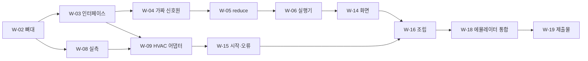

# 개발 계획 — 첫 탑승 조작 실습 (가칭)

- 문서 상태: 초안 v0.1 (2026-11-14)
- 관련 문서: [PRD](01-prd.md) · [기능 명세서](03-feature-spec.md) · [사용자 플로우](04-user-flow.md) · [정책서](05-policy.md) · [기술 설계](06-tech-design.md)
- 표기: **[가정]** 은 근거 없이 정한 값, **[미정]** 은 팀 결정이 필요한 항목, **[실측]** 은 에뮬레이터에서 확인한 뒤 확정하는 항목이다.
- 이 문서는 **2인 팀**이 MVP까지 무엇을 어떤 순서로 누가 만드는지를 정한다. 기술 설계 3절의 3인 담당표(A·B·C)와 설계 목표 G3의 "세 명"은 이 문서의 2인 담당표로 대체한다.

## 1. 전제

| 항목 | 내용 |
|---|---|
| MVP | **2차 PT 시연본.** PRD 6-2절의 M1~M7을 모두 만족하는 빌드다 |
| MVP 기한 | 12-02(수) 시연본 확정. PT는 12-03(목)~04(금) |
| 중간 기한 | 11-15(일) 23:59 접수. 기획서는 필수, 영상과 GitHub(소스 + release APK)는 가산점 |
| 인원 | 2명 |
| 에뮬레이터 장비 | 2대. 두 사람 모두 자기 장비에서 에뮬레이터를 돌릴 수 있다(2026-11-14 확인). B의 장비(RTX 3060 12GB)는 설치와 실행까지 확인했고, A의 장비는 W-20에서 확인한다 |
| 개발 범위 | 기능 명세서의 Must와 Should. Could(FR-15 프로필)는 계획에 넣지 않는다 |
| 계획 밖 | 기획서, PT 발표 자료. 이 문서의 추정 시간에 들어 있지 않다(4-3절 참조) |

### 현재 상태 (2026-11-14 03시)

| 항목 | 상태 |
|---|---|
| 문서 | 6종 초안 v0.1. 와이어프레임 v0.1(프레임 크기는 가정) |
| 코드 | 없음 |
| 실측 T1 | **통과.** Pleos Connect v2.1.0 (rev 2) 에뮬레이터 부팅, VC 접속, VC의 공조 전원 변경이 에뮬레이터에 반영되는 것을 확인했다 |
| 화면 규격 | 2560×1440, 160dpi, API 34. 앱 창은 화면의 오른쪽 약 2/3. 정확한 창 크기는 실측 G1 |
| 빌드 환경 | WSL에서 JDK 17, AGP 8.8.2, Gradle 8.10.2, Kotlin 2.0.0, minSdk 28로 서명된 release APK를 만들어 에뮬레이터에 설치·실행했다 |
| `:engine` 구성 (A, 11-14) | Kotlin 2.0.0(jvm, serialization 플러그인), coroutines 1.8.1, serialization-json 1.6.3, 테스트는 `kotlin("test")`와 coroutines-test, `java-test-fixtures`. 패키지는 `com.firstride.engine`(임시). W-03(고정 인터페이스)은 `main`에 병합됐다. Gradle wrapper는 아직 없다 |
| JDK 주의 | A의 장비(Windows)에서 Eclipse Adoptium JDK 17.0.5는 Gradle 데몬이 `Bad address: listen`으로 죽는다. Amazon Corretto 17.0.12로 해결했다 |
| 원격 작업 | B가 11-15 저녁까지 원격(SSH, 원격 데스크톱)으로만 자기 장비를 쓴다. 맥북 마이크가 에뮬레이터로 넘어가지 않아 B는 이 기간에 STT 실측(T9)을 하기 어렵다 |
| 미검증 | OBS 녹화(화면 2개 + TTS 소리). 시연 영상의 전제다 |
| 팀 결정 | D1(앱 이름), D2(기준 차종), D3(김서림 제거 목표 조합) 미정. 기한이 오늘이다 |

## 2. 담당

기술 설계 3절의 C(화면·자산)를 둘로 갈라 A와 B에 붙인다. 누가 A이고 B인지는 **[미정]** 이다. B는 실측을 이미 시작한 장비(T1 통과)를 가진 사람이 맡는다.

| 담당 | 범위 | 에뮬레이터를 쓰는 곳 |
|---|---|---|
| **A — 엔진·화면** | `:engine` 전부(판정, 코스 모델·검증, 음성 조율, 배지 규칙), 코스 정의 JSON, Compose 화면, debug 개발자 패널, L1·L2 테스트 | 개발은 가짜 신호원으로 한다. 자기가 만든 화면과 코스의 확인(L3)만 자기 장비에서 한다 |
| **B — 플랫폼·통합** | 실측(T2~T15, G1), `:platform` 전부(SDK 어댑터, TTS·STT, 주행 제한, 저장소), `:app` 조립(매니페스트, `AppViewModel`, 생명주기), 빌드·서명·APK·CI, 어댑터의 L3, L4 테스트, 시연 영상 | 실측과 어댑터 개발 전부 |
| 공동 | 인터페이스 고정, 팀 결정(D1~D7), 코드 리뷰, 사용성 테스트 | |
| **[미정]** | 위치 안내 자산 제작(기준 차종의 버튼 배치를 직접 볼 수 있는 사람), 기획서, PT 자료 | |

2인이라서 생기는 제약:

- **실측은 B 한 사람이 한다.** 장비는 두 대지만 실측 기록을 한곳에 모으고 A의 시간을 엔진과 화면에 쓰기 위해서다. A는 가짜 신호원으로 수용 기준을 테스트로 통과시킨 뒤 자기 장비에서 확인만 한다. B의 장비에 문제가 생기면 A의 장비가 예비다.
- **리뷰어가 한 명이다.** 모든 변경을 리뷰하지 않는다. `reduce`가 있는 파일과 3절의 고정 인터페이스를 바꾸는 변경만 상대의 승인을 받는다.
- **한 사람이 빠지면 그 영역이 멈춘다.** 인터페이스와 실측 결과를 문서에 남겨 다른 사람이 이어받을 수 있게 한다.

## 3. 먼저 고정하는 것

두 사람이 서로를 기다리지 않으려면 아래 다섯 가지를 **첫 작업으로** `main`에 넣는다. 이후에는 두 사람이 합의해야 바꾼다.

| 고정 대상 | 근거 |
|---|---|
| `SignalSource`, `SignalId`, `SignalValue`, `Reading`, `Support` | 기술 설계 4-1절 |
| 신호 ID와 값 토큰 목록 | 기술 설계 4-3절. 실측 T6으로 값이 달라지면 어댑터가 흡수한다 |
| 코스 정의 형식(차종 공통 파일, 차종별 파일) | 기술 설계 6-2절 |
| `TtsPort`, `SttPort`, `ProgressStore`, `DrivingGate` | 기술 설계 7-1절, 5-7절, 8-1절 |
| 패키지 이름과 모듈 경계 | 기술 설계 3절. 패키지 이름은 D1(앱 이름)에 묶인다. 정해지기 전의 임시값은 `com.firstride`다(`:engine`은 `com.firstride.engine`) |

## 4. 1단계 — 11-15 접수 제출본

### 4-1. 목표

기능 명세서 1절의 "11-15" 열이 ●인 것만 만든다: FR-01, 02, 03, 04, 05, 11, 12, 13과 대표 코스 CRS-01. 화면은 세로형만 만든다. ○인 항목(STT, 주행 전환, CRS-02~06, 소등 확인)은 **계획에 넣지 않는다.** 코드 동결 전에 ●가 모두 끝났을 때만 4-4절 순서로 더한다.

끝났다는 기준: 에뮬레이터에서 VC로 신호를 바꿔 CRS-01을 완주하고, AC-CRS01-1~4가 모두 통과한다.

### 4-2. 작업

추정 시간은 AI 코딩 도구를 쓰는 기준의 어림값이다 **[가정]**.

| ID | 작업 | 담당 | 선행 | 완료 기준 | 추정(h) |
|---|---|---|---|---|---|
| W-01 | 팀 결정 D1·D2·D3. 못 정하면 임시값으로 진행하고 `[가정]`으로 적는다 | 공동 | — | PRD 10절 갱신 | 0.5 |
| W-02 | Gradle 3모듈 뼈대, Pleos Maven 저장소와 SDK 3종 의존성 해석, release 서명, `apk/` 복사 작업. A가 넣은 `settings.gradle.kts`(`:engine`만 있음)와 합치고 Gradle wrapper를 추가한다. `:app`이 `:engine`의 test fixtures를 debug에서만 가져오는 구성을 확인한다(실측 T17) | B | W-01 | `./gradlew :engine:test assembleRelease` 성공, 에뮬레이터에 설치 (NFR-13). release APK에 가짜 구현이 없다 | 2 |
| W-03 | 3절의 인터페이스를 코드로 작성 | A 작성, B 리뷰 | W-02 | `main`에 병합 | 1.5 |
| W-04 | `FakeSignalSource`, 코스 모델, JSON 파서 | A | W-03 | 기술 설계 4-2절의 API | 2 |
| W-05 | `reduce`, 조건 상태, `Target.Equals`, L1 테스트 | A | W-04 | AC-02-2·3·4·5·6·11·12·13·14와 AC-CRS01-1~4가 테스트로 통과. 테스트 이름에 정책 ID | 5 |
| W-06 | `StepRunner`(3초·15초·2초), `CourseRunner`, L2 테스트 | A | W-05 | AC-02-7·8·10 (가상 시간) | 4 |
| W-07 | `CourseValidator`, `CRS-01.json`(공통·차종별), 정의 검증 테스트 | A | W-04 | AC-13-1~4 | 2 |
| W-08 | 실측 앱(화면 1개)과 실측 T2·T3·T4·T6·T7·T13·G1. CRS-01의 신호 3개부터 | B | W-02 | 기술 설계 13-3절 결과 칸 기록. **게이트 G-1** | 4 |
| W-09 | HVAC 어댑터 3종(앞유리 제상, 에어컨, 순환) | B | W-03, W-08 | 기술 설계 4-1절 계약 5개. 수집 취소 시 구독 해제 | 3 |
| W-10 | 실측 T8, `TtsPort` 어댑터 | B | W-02 | 한국어 `ON_DEVICE` 재생, 재생 종료 대기, 중지 | 2 |
| W-11 | 음성 안내 조율(TTS만): 끊기, 같은 문구 3초, 최신만 | A | W-03 | AC-05-1~5 (가짜 `TtsPort`) | 2.5 |
| W-12 | `ProgressStore`의 DataStore 구현 | B | W-03 | AC-11-1·5·6·7 | 1.5 |
| W-13 | `Screen`, `AppViewModel`, 앱 시작 시 조립 | B | W-03 | 가짜 신호원(debug)과 실제 어댑터(release)를 바꿔 끼울 수 있다 | 2 |
| W-14 | 테마·공통 컴포넌트, SCR-02·03·04(상태 8개)·05 세로형, debug 개발자 패널 | A | W-06, W-13 | AC-03-1~4, AC-04-1~7. **SCR-04를 먼저** 만들어 11-15 정오까지 B에게 넘긴다 | 7 |
| W-15 | SCR-01·09, SCR-10 최소(기록 지우기), 지원 여부 확인과 코스 숨김, 오류 대응 | B | W-09 | AC-01-1~5, AC-11-3, AC-12-1~4 | 4 |
| W-16 | 실습 범위 취소(백그라운드, 화면 이탈), 매니페스트 | B | W-14, W-15 | AC-02-10, AC-11-2. 퍼미션은 `CAR_CLIMATE`, `TTS_SERVICE`만 (POL-S-10) | 2 |
| W-17 | CRS-01 위치 안내 자산(제상·A/C·순환 버튼) | B (11-14 결정) | W-01 | AC-08-2, POL-W-11 | 2 |
| W-18 | 에뮬레이터 통합 확인(L3) | B. A는 자기 장비에서 SCR-04의 상태별 화면 확인 | W-16, W-17 | AC-CRS01-1~4, AC-02-1의 지연 실측, 판정 품질 기준 Q1~Q6 | 3 |
| W-19 | release APK, README 필수 항목, 시연 영상, 커밋 해시 | B(APK·영상), A(README) | W-18 | 기술 설계 14절 | 3 |
| W-20 | A의 장비에 에뮬레이터와 VC 설치·실행 확인 | A | — | 부팅, VC 변경 반영, 앱 설치. 대부분 내려받는 시간이라 다른 작업과 겹쳐 한다. 늦어지면 11-16으로 미룬다(1단계의 필수 경로가 아니다) | 1.5 |

합계는 A 약 26시간, B 약 26시간이다.

### 4-3. 시간표

| 구간 | A | B | 구간이 끝났을 때 |
|---|---|---|---|
| 11-14 오전 | W-03, W-04, W-20 내려받기 시작 | W-01 취합, W-02, **OBS 30초 녹화 시험** | 3모듈이 빌드되고 인터페이스가 `main`에 있다 |
| 11-14 오후 | W-05 | W-08, W-10 | `reduce` 테스트 통과. **G-1**: CRS-01 신호 3개가 읽히고 변화가 전달된다 |
| 11-14 밤 | W-06, W-07 | W-09, W-12, W-13 | 가짜 신호원으로 CRS-01이 테스트에서 완주한다. 어댑터가 VC 변경을 `Reading`으로 낸다 |
| 11-15 오전 | W-14 (SCR-04 먼저) | W-15 | SCR-04가 가짜 신호원으로 8개 상태를 모두 그린다 |
| 11-15 오후 | W-14 마무리, W-11 | W-16, W-18 | **18:00 코드 동결 (G-2).** 에뮬레이터에서 CRS-01 완주 |
| 11-15 저녁 | README | W-19 | **22:00 제출.** 마감까지 2시간을 남긴다 |

**여유가 없다.** 지금부터 코드 동결까지 39시간이고 잠과 식사를 빼면 한 사람당 27시간 안팎인데, 작업 합계가 26시간 안팎이다. 기획서를 쓸 시간은 여기에 없다. 제출에 **필수인 것은 기획서뿐**이므로, 기획서에 쓸 시간만큼 4-4절의 순서대로 범위를 줄인다. 기획서의 개발 계획 항목은 기술 설계 10-4절을 원본으로 쓴다.

### 4-4. 넣는 순서와 빼는 순서

●가 일찍 끝나면 아래 순서로 더한다. 판정 품질 기준(FR-08)을 통과한 것만 넣는다.

1. CRS-03 전조등·미등 (Light 어댑터 2종. `ALREADY_AT_TARGET` 시연에 쓴다)
2. CHK-01 소등 확인 (실내등 어댑터 추가)
3. CRS-04 와이퍼

늦어지면 아래 순서로 뺀다.

1. debug 개발자 패널의 편의 기능, 힌트 재안내(15초)
2. SCR-03 코스 소개의 내용(시작 버튼만 남긴다)
3. 음성 안내(FR-05). 화면 문구만으로 완주할 수 있다(AC-05-4). 뺐다면 README와 영상에 밝힌다
4. **최소선**: `:engine`과 테스트, HVAC 어댑터, SCR-02·04의 세로형으로 CRS-01 완주. 여기까지 안 되면 APK와 영상을 내지 않고 기획서와 소스만 제출한다

## 5. 2단계 — Must 완성 (11-16 월 ~ 11-20 금)

1차 결과(11-23)를 기다리지 않고 진행한다 **[가정]**. 결과 뒤에 시작하면 PT까지 10일이라 Should를 넣을 수 없다.

끝났다는 기준(M2): FR-01~07, FR-10~13, CRS-01·03·04, CHK-01이 수용 기준을 모두 통과한다. 실측 T1~T15의 결과 칸이 채워져 있다.

| ID | 작업 | 담당 | 선행 | 완료 기준 | 추정(h) |
|---|---|---|---|---|---|
| W-21 | 저장소 공개 전환(11-16), GitHub Actions로 `:engine:test`. 원격 접속 정보가 든 파일이 커밋에 없는지 확인 | B | W-19 | 기술 설계 9-4절 | 1 |
| W-22 | 실측 T9(한국어 인식, 이어 듣기, 마이크 퍼미션). 장비 앞에서 한다. 1단계의 ●가 일찍 끝나면 A가 자기 장비에서 먼저 본다 | B | — | **게이트 G-3.** D5 결정, 인식 결과의 변형 기록 | 3 |
| W-23 | `SttPort` 어댑터 | B | W-22 | 최종 결과만 반환, 무음 처리, 중지 | 3 |
| W-24 | `matchVocabulary`와 변형 표, `VoiceCoordinator` 전체(듣기, 되묻기 6초) | A | W-11 | AC-06-2·3·4·5·8·9·10 (가짜 포트) | 5 |
| W-25 | SCR-04의 음성 표시(듣는 중, 음성 꺼짐, D5에 따라 마이크 버튼) | A | W-24 | AC-06-6·7 | 2 |
| W-26 | 실측 T10·T14·T15, `DrivingGate` 구현, 최상위 분기와 SCR-08, 이어서 하기(30분) | B | — | **게이트 G-4.** AC-07-1~7 | 5 |
| W-27 | Light 어댑터 3종과 실측 T12, Wiper 어댑터 | B | W-09 | 계약 5개. 외부등 모드와 두 신호의 관계 기록 | 4 |
| W-28 | CRS-03·04 정의, 와이퍼 오조작 규칙 | A | W-27의 T6·T12 결과 | AC-CRS03-1·2, AC-CRS04-1 | 2 |
| W-29 | SCR-06 소등 확인 | A | W-14 | AC-10-1~7 | 3 |
| W-30 | SCR-10 완성(음성 켜기/끄기, 숨긴 코스와 이유) | A | W-15 | POL-C-3, POL-S-5, POL-S-11 | 2 |
| W-31 | 무작위 사건열 테스트 | A | W-06 | 기술 설계 9-3절의 조건이 수천 회에서 참 (PRD M1) | 3 |
| W-32 | CRS-03·04 위치 안내 자산 | **[미정]** | D2 | AC-08-2 | 3 |
| W-33 | 에뮬레이터 통합 확인(L3). A: CRS-03·04, CHK-01, 음성 진행. B: 어댑터, 주행 전환 | A, B | 위 전부 | AC-06-1(터치 없이 대표 코스 완주), AC-07-1, AC-10-4 | 3 |

합계는 A 약 19시간, B 약 18시간이다. 이 주에 D6(묶음과 배지 이름)과 D7(프로필 포함 여부)도 정한다(기한 11-20).

## 6. 3단계 — Should, 가로형, 기능 동결 (11-21 토 ~ 11-27 금)

끝났다는 기준(M3): 6개 코스 가운데 판정 품질 기준을 통과한 것이 확정되고, 모든 화면이 세로형과 가로형에서 깨지지 않는다. **11-27에 기능을 동결한다(G-6).** 이날까지 기준을 통과하지 못한 코스와 기능은 빌드에서 뺀다.

| ID | 작업 | 담당 | 선행 | 완료 기준 | 추정(h) |
|---|---|---|---|---|---|
| W-34 | `Target.Relative`, 끝값일 때의 대체 안내 | A | W-05 | POL-J-10, AC-CRS02-1 | 2 |
| W-35 | 어댑터: 뒷유리 제상, 풍량, 풍향(폴링, 실측 T5), 방향지시등, 창문 위치(영역), 창문 잠금, 도어 잠금 | B | W-09 | 계약 5개. 메서드 이름과 값 목록을 기술 설계 10-2절에 기록 | 6 |
| W-36 | CRS-02·05·06 정의 | A | W-34, W-35의 값 목록 | AC-CRS02-1·2, AC-CRS05-1, AC-CRS06-1 | 3 |
| W-37 | `BadgeRule`, `bundles.json`, 홈의 묶음 표시, SCR-07 | A | D6 | AC-09-1~4 | 3 |
| W-38 | 실습 후 원상 복귀 안내(SCR-05) | A | W-14 | AC-14-1~3 | 2 |
| W-39 | 가로형 배치(전 화면), 주간·야간 테마, 누름 효과. 자기 장비의 에뮬레이터에서 창 크기를 바꿔 가며 확인한다 | A | G1, T15 | POL-U-1·2·3, AC-04-8 | 6 |
| W-40 | 오디오 포커스, 실측 T11(확인 불가 재현), 성능 측정 | B | W-10 | POL-V-7, NFR-01~05 | 5 |
| W-41 | CRS-02·05·06 위치 안내 자산 | **[미정]** | D2 | AC-08-2 | 4 |
| W-42 | 에뮬레이터 통합 확인(L3): Should 코스, 배지 | B | 위 전부 | AC-08-1·3, AC-CRS02-2 | 4 |
| W-67 | 단계 화면 가로형의 "지금 차 상태" 판(`StatePanel`) | A | PR #37 | AC-04-9~11 | 2 |
| W-68 | 홈에서 권할 다음 코스를 고르는 순수 함수(`nextCourse`)와 단위 테스트 | A | — | 규칙 1~4와 빈 목록이 테스트로 통과 | 1 |
| W-69 | 상태 기호에 "건너뜀 있음"·"시작 전" 추가(`Mark.SKIPPED`, `Mark.EMPTY`) | A | PR #37 | 주간·야간에서 색 없이 구분(POL-U-4) | 0.5 |
| W-70 | 홈 가로형 오른쪽 칸의 진행 현황과 "다음에 익힐 코스" 카드 | A | W-68, W-69, W-37 | AC-03-6~10 | 3.5 |
| W-71 | W-67·W-70의 문서 고치기(용어집, 기능 명세, 디자인 값, DESIGN.md) | A | PR #36 | 문서와 화면이 어긋나지 않는다 | 1 |
| W-72 | 에뮬레이터 통합 확인(L3): W-67·W-70 | B | W-67, W-70 | 빈 화면 채우기 개발 계획 4절의 확인표 | 1.5 |

합계는 A 약 24시간, B 약 16.5시간이다. W-67~72는 가로형의 빈 자리를 채우는 작업이다(빈 화면 채우기 기획안). 11-26까지 W-72를 통과하지 못하면 W-70을 빼고 홈 오른쪽 칸을 그대로 둔다. 11-23에 1차 결과가 나온다(G-5).

## 7. 4단계 — 검증과 시연 준비 (11-28 토 ~ 12-02 수)

새 기능을 넣지 않는다. 버그 수정과 확인만 한다.

| ID | 작업 | 담당 | 완료 기준 |
|---|---|---|---|
| W-43 | 시연 흐름 13장면(사용자 플로우 8절)을 "VC │ 앱" 2분할로 끝까지. 장면별 VC 초기 상태를 적어 둔다 | B | L4 통과. 장면 12·13은 G-4와 T11 결과에 따른다 |
| W-44 | 사용성 테스트 5명 | 공동 | PRD M2(5명 중 4명 이상), M3(90초), M5 |
| W-45 | 수용 기준 전수 점검표 | A | PRD M7. 기능 명세서의 AC마다 통과·제외를 표시 |
| W-46 | 버그 수정 | 공동 | 남은 결함이 시연 흐름에 없다 |
| W-47 | README 최종(알려진 한계, 뺀 코스와 이유), 문서의 `[실측]` 표시 정리 | A | 기술 설계 14절 |
| W-48 | release APK 최종 빌드와 태그, 예비 시연 영상 | B | 12-02 시연본 확정 |

PRD 6-3절의 자기체크 방식 비교 검증은 비교용 화면("했어요" 버튼)을 따로 만들어야 해서 개발 범위가 늘어난다. 넣을지는 **[미정]** 이고, 넣는다면 debug 빌드에만 둔다.

## 8. MVP 완료 기준과 작업의 대응

| PRD 기준 | 확인하는 작업 | 방법 |
|---|---|---|
| M1 허위 완료 0건 | W-05, W-06, W-31 | 자동 테스트. PR마다 CI에서 돈다 |
| M2 음성 안내만 듣고 대표 코스 완료 | W-44 | 사용성 테스트 |
| M3 대표 코스 90초 이내 | W-44 | 사용성 테스트에서 관찰로 잰다(앱은 시간을 저장하지 않는다, POL-R-9) |
| M4 판정 반응 1초 이내 | W-18, W-33 | 실측 앱의 콜백 시각과 화면 반영 시각 |
| M5 터치 없이 한 코스 완주 | W-33 | 에뮬레이터 수동 |
| M6 주행 전환 1초 이내 | W-26, W-33 | 실측 T10을 통과했을 때만 시연한다 |
| M7 6개 코스와 소등 확인의 품질 기준 통과 | W-45 | 전수 점검표 |

## 9. 게이트

결과에 따라 계획이 갈리는 지점이다.

| # | 시점 | 확인하는 것 | 안 되면 |
|---|---|---|---|
| G-1 | 11-14 오후 | CRS-01의 신호 3개가 읽히고 VC 변경이 전달된다 | 콜백만 안 오면 어댑터를 폴링으로 바꾼다. 조회도 안 되면 대표 코스를 읽히는 도메인의 코스로 바꿀지 팀이 정한다(PRD 9절) |
| G-2 | 11-15 18:00 | 에뮬레이터에서 CRS-01 완주 | 4-4절의 빼는 순서 |
| G-3 | 11-17 무렵 | STT가 `ON_DEVICE` 한국어로 동작하고 이어 듣기가 된다 | 기술 설계 11절의 분기. 동작하지 않으면 팀 결정이 필요하다 |
| G-4 | 11-18 무렵 | VC의 기어 주입이 주행 제한에 반영된다 | FR-07은 단위 테스트까지만 하고 시연에서 뺀다 |
| G-5 | 11-23 | 1차 결과 | 탈락이면 이후 계획을 계속할지 팀이 정한다 |
| G-6 | 11-27 | 코스별 판정 품질 기준 통과 | 통과하지 못한 코스를 뺀다 |

3단계에서 시간이 모자라면 FR-14(원상 복귀) → CRS-06 → CRS-05 → CRS-02 → FR-09(배지) 순서로 뺀다. Must와 가로형 지원(POL-U-1)은 빼지 않는다.

## 10. 일하는 규칙

- 브랜치는 git flow를 따른다(2026-11-14부터).

  | 브랜치 | 쓰임 | 규칙 |
  |---|---|---|
  | `main` | 제출본과 시연본만 | 직접 커밋하지 않는다. 릴리스 브랜치를 통해서만 들어간다 |
  | `develop` | 통합 브랜치 | 항상 빌드되고 `:engine:test`가 통과한다 |
  | `feature/W-번호-짧은-이름` | 작업 하나 | `develop`에서 만들고 PR로 `develop`에 넣는다. 예: `feature/W-09-hvac-adapter` |
  | `release/버전` | 제출·시연 준비 | 11-15 제출본은 `release/0.1.0`, MVP는 `release/1.0.0`. `main`과 `develop`에 병합한다 |
  | `hotfix/이름` | `main`의 급한 수정 | `main`과 `develop`에 병합한다 |

- 병합은 병합 커밋을 남긴다(`--no-ff`). W-번호 하나에 PR 하나가 기본이다. 이미 올린 브랜치는 리베이스하지 않고 `origin/develop`을 병합해 맞춘다.
- 상대의 승인이 필요한 변경은 둘이다. `reduce`가 있는 파일, 3절의 고정 인터페이스. 나머지는 빌드와 `:engine:test`가 통과하면 스스로 `develop`에 병합한다.
- 테스트 이름에 정책 ID를 넣는다(기술 설계 9-2절). 수용 기준을 통과시킨 PR은 설명에 AC 번호를 적는다.
- 실측 결과는 그날 기술 설계 13-3절의 결과 칸에 적는다. A가 코스 정의의 값을 여기서 가져간다.
- 가짜 신호원은 `engine/src/testFixtures/`에 두고 `:app`은 `debugImplementation(testFixtures(project(":engine")))`로만 가져온다. 개발자 패널은 `app/src/debug/`에만 둔다. 둘 다 release APK에 들어가지 않는다(기술 설계 4-2절).
- 하루에 한 번 15분 동안 맞춘다: 끝낸 W-번호, 막힌 것, 인터페이스 변경 요청.
- 에뮬레이터 확인은 만든 사람이 자기 장비에서 한다. PR에 VC에서 바꾼 값과 본 결과를 적는다. 실측 항목(T, G 번호)만 B가 맡는다.
- 두 장비의 에뮬레이터 버전(v2.1.0 rev 2)과 AVD 설정을 같게 둔다. 한쪽에서만 재현되는 문제는 실측 표에 적는다.
- release 서명 키는 저장소로 옮기지 않는다. A의 장비를 제출용 예비로 쓰려면 키 사본을 다른 경로로 미리 넘겨 둔다.

## 11. 위험

| 위험 | 영향 | 대응 |
|---|---|---|
| 1단계에 여유 시간이 없다 | 제출본 미완성 | 4-4절의 빼는 순서를 미리 합의한다. 기획서를 먼저 확보한다 |
| 원격 접속 중 B의 장비가 재부팅되거나 접속이 끊긴다 | B의 작업 중단 | A의 장비(W-20)에서 통합 확인, APK 빌드, 영상 녹화를 이어 간다. 서명 키 사본이 A에게 있어야 한다. A의 장비도 준비되지 않았으면 최소선으로 제출한다 |
| OBS 녹화를 한 번도 해 보지 않았다 | 시연 영상 없음 | 11-14 오전에 30초 시험 녹화. 안 되면 `adb`의 화면 녹화로 대신한다(TTS 소리는 빠진다) |
| B가 STT를 원격으로 시험할 수 없다 | FR-06이 11-15 제출본에서 빠진다 | 처음부터 2단계로 미뤘다. A의 장비에서는 마이크를 쓸 수 있어 A에게 시간이 남으면 T9를 앞당긴다 |
| 메서드 이름이 확인되지 않은 신호가 6개다 | 어댑터 지연 | W-08에서 IDE 자동 완성으로 확정. 1단계에는 HVAC 3종만 필요하다 |
| 위치 안내 자산의 담당이 없다 | 자산이 없는 코스는 빌드에 못 넣는다(POL-C-7) | 오늘 담당을 정한다. 1단계에는 3장만 필요하다 |
| 실측과 어댑터가 B 한 사람에게 있다 | 2~3단계 지연 | 화면과 화면의 에뮬레이터 확인은 모두 A가 맡았다. B의 화면 작업은 SCR-01·08·09뿐이다. B가 밀리면 A가 자기 장비에서 실측 항목을 나눠 맡는다 |

## 12. 정하지 않은 것

| # | 항목 | 정하는 때 |
|---|---|---|
| 1 | 누가 A이고 누가 B인가 | 오늘 |
| 2 | 위치 안내 자산, 기획서, PT 자료의 담당 | 오늘 |
| 3 | 11-16 이후 한 사람이 하루에 쓸 수 있는 시간. 5~7절의 합계와 맞춰 본다 | 11-16 |
| 4 | 자기체크 비교 검증을 할 것인가 | 11-27 |
